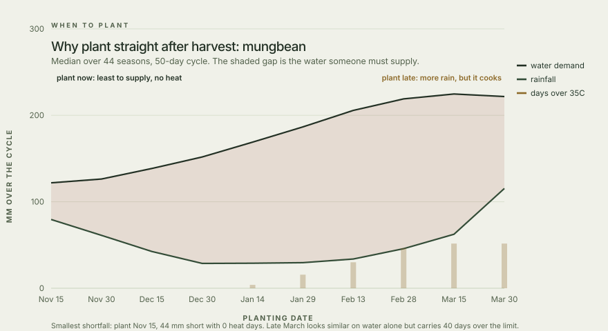
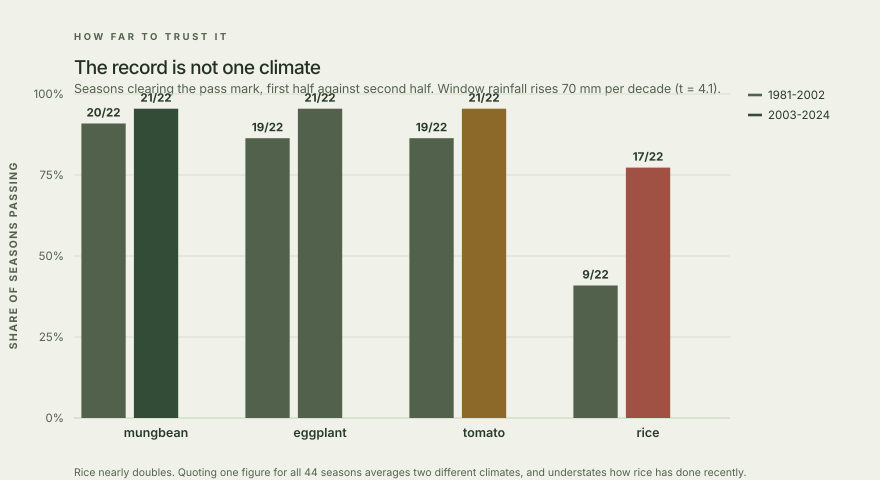

# AniNow Klima

AniNow Klima helps Filipino rice farmers compare what to plant after harvest: rice again or a locally supported rotation crop. It combines NASA environmental evidence, local agricultural knowledge, and farmer priorities to explain the risks, requirements, and potential returns of each option.

Planned for NASA Space Apps [Field Shift: Adapting Farms with NASA Data](https://www.spaceappschallenge.org/2026/challenges/field-shift-adapting-farms-with-nasa-data/).

**Status.** The decision model runs. `model/` holds a working requirement-matching model over 44 seasons of NASA POWER data for **seven places** from Ilocos Norte to Bukidnon and **ten crops**, with a FAO-56 water balance, measured soil from the nearest SARAI sample, a local web form, a diagnostics suite and the charts below. The farmer's main crop can be any of the ten. The pilot field at Muñoz, Nueva Ecija (15.72 N, 120.90 E) is the one reviewed in detail and the one the charts describe. There is still no web application, database deployment or trained predictive model, and validated yield prediction remains a separate milestone. [docs/HANDOFF.md](docs/HANDOFF.md) is the current summary.

Every chart on this page is generated by `model/charts.py` from the model's own output. None of them illustrate what a result might look like.

---

## What it says for the pilot field

The farmer answers that water drains off the field and that there is no irrigation. The gap between harvest and the next rice planting is **197 days**.

| Crop | Cycle | Suitability | Seasons passing | 95% interval | Water short by |
|---|---|---|---|---|---|
| **Mungbean** (munggo) | 50 d | **0.64** | **22 of 41** | 39%–68% | **44 mm** |
| Eggplant (talong) | 70 d | 0.42 | 13 of 41 | 20%–47% | 115 mm |
| Tomato (kamatis) | 70 d | 0.39 | 13 of 41 | 20%–47% | 127 mm |
| Rice again (palay) | 106 d | 0.11 | 0 of 41 | 0%–9% | 964 mm |

Suitability is the crop's weakest condition in a typical season. At this field that is always water, so 0.64 means rain covered 64% of what mungbean needed. A season passes at 0.6 or better.

Counts are out of 41, not 44: reference evapotranspiration needs a radiation record that starts in 1984, so the 1981–1983 seasons have no water score and are left out rather than counted as passes.

Rice's growing time is the 106 days of NSIC Rc222 when direct seeded, from the Pinoy Rice Knowledge Bank; the other three crops still use the shortest time on their EcoCrop sheet, which is a global figure. The order holds whichever end of each range is used; see the [audit](docs/Audit-and-Decision-Checklist.md).

Mungbean leads on every farmer priority and needs roughly one twenty-second of the supplemental water that planting rice again would need. These are **historical frequencies, not predictions**, and the model is not trained on crop outcomes.

### Beyond the pilot: seven places, ten crops

The same answers at each place (harvest 15 November, next planting 31 May, rain only, main crop rice), from `python model/insights.py`:

| Place | Soil | Rain in the window | Leading crop | Rain covers | Good years | Extra water | Against rice |
|---|---|---|---|---|---|---|---|
| Science City of Muñoz, Nueva Ecija | pH 6.3, medium | 379 mm | Munggo | 64% | 22 of 41 | 44 mm | 920 mm less |
| Batac, Ilocos Norte | pH 7.5, heavy | 305 mm | Habichuelas | 45% | 17 of 41 | 87 mm | 589 mm less |
| Echague, Isabela | pH 5.4, medium | 922 mm | Munggo | 100% | 41 of 41 | 0 mm | 370 mm less |
| Los Baños, Laguna | pH 6.9, medium | 940 mm | Habichuelas | 100% | 41 of 41 | 0 mm | 285 mm less |
| Ligao, Albay | pH 5.6, light | 1,269 mm | Kalabasa | 100% | 41 of 41 | 0 mm | 184 mm less |
| Lambunao, Iloilo | pH 6.8, medium | 596 mm | Munggo | 100% | 40 of 41 | 0 mm | 570 mm less |
| Maramag, Bukidnon | pH 4.9, heavy | 787 mm | Munggo | 100% | 0 of 41 | 0 mm | 309 mm less |

The leading crop changes with the place, and so does the list of crops ruled out: cabbage, lettuce and potato are not recommended in the warm lowlands. Each place has its own NASA POWER download and its own measured soil sample. Six of the ten crops (squash, sitaw, snap bean, cabbage, lettuce, potato) are known only from a DA crop guide's recommended range, so they are screened on it and not scored on a slope. Only the Muñoz figures have been reviewed in detail.

### When to plant, and why November



The gap between the two lines is water somebody has to supply. Rainfall inside the window is very uneven — December to March runs 15–36 mm per month while May runs 182 mm — so planting late catches more rain. A 60-day mungbean planted 30 March gets 205 mm against 32 mm planted 14 January.

But reference evapotranspiration climbs from 3.25 mm/day in November to 6.02 mm/day in April, and a cycle planted in late March spends **42 of its 60 days above 35 °C** (the amber bars). Planting immediately after harvest has both the smallest shortfall and no heat-stressed days. That is also what farmers already do, so the model arrives at established practice from the data.

---

## How it works


Sources on the left, what was done to them, what came out. The dashed grey box is a source that was fetched, tested and **rejected** — it is drawn in deliberately, because a dead end is part of the method.

### A published limit becomes a score


Each condition is scored from four numbers published on the crop's EcoCrop sheet: the score is 1 inside the optimal range, falls in a straight line to 0 at the absolute limit, and is 0 beyond it. **No margin in this shape is ours**, which is why the curve can be checked against the source.

### Rainfall becomes water demand


Demand is built day by day: reference ET from temperature and top-of-atmosphere radiation (FAO-56 Eq. 52), scaled by the crop's own coefficient curve through four growth stages, plus percolation for paddy. Supply is rainfall over the same days. The water score is **relative water supply**, `rain ÷ ETc`, capped at 1 — a comparison for this field and this window, not a regional climate envelope.

### Four scores become one verdict


A season's score is **the lowest of the four conditions**: heat, water, soil pH and soil texture. Nothing is averaged, so good soil cannot make up for missing water. This is the rule EcoCrop's own model uses and the limiting-condition method of FAO land evaluation. Rice scores 1.00 on heat, pH and texture and still ranks last, because water is 0.11. The farmer's priority changes the order of the crops, never a score.

### Every season, not just the median


Faded dots are dry seasons, rings are El Niño seasons. Water is the only condition that varies between seasons here, so it sets the height of every dot.

---

## How far the numbers can be trusted

The arithmetic is verified: reference ET reproduces an independent hand calculation to the decimal across seven months, crop water demand agrees with FAO's published per-cycle figures, and 107 tests cover the farmer-facing inputs and the statistics. The statistics are weaker, and two problems are material.

### The record is not one climate



Window rainfall rises **+70.5 mm per decade (t = 4.14)**, and the trend holds in every slice of the window. Split the record in half and mungbean clears the pass mark in 6 of the first 20 scored seasons against 16 of the last 21. **Quoting "22 of 41" to a farmer deciding for 2026 understates how mungbean has done recently.** This is a trend in the NASA record; it has not been checked against a rain gauge.

### The rainfall input disagrees with itself


POWER's two precipitation columns correlate at r = 0.745 but `PRECTOTCORR` reads **19% lower**. Every shortfall here is rainfall subtracted from demand, so that spread passes straight into the headline figures. It is also not yet an IMERG cross-check: POWER's header labels that column MERRA-2.

### Seasons are not quite independent draws


The 95% intervals assume independence. For eggplant and tomato the lag-1 autocorrelation of the pass indicator is close to zero, so their intervals are fine. Mungbean is +0.142, giving it an **effective sample of 31 rather than 41**, so its interval is a little too narrow.

### The pass mark does not decide the leader


Mungbean leads at every pass mark from 0.4 to 0.8. The mark changes how many seasons count as good (30 of 41 at 0.4, 15 of 41 at 0.8), not which crop comes first. The 0.6 is still a team choice.

### What the inputs actually cover


`-999` is read as missing, never as zero and never averaged in. Reference ET needs radiation, so it cannot start before 1984. A season missing any day of a variable the model needs is dropped from that statistic rather than filled.

### What cannot be claimed at all

There is **no validation against crop outcomes**, because none exists for this field. Accuracy, precision, recall and any "model performance" figure are unavailable, and presenting one would be the most damaging thing this project could do.

[The full narrative](docs/Model-Narrative.md) covers the method, every source, the compromises in the soil data, the source that was rejected, and the EcoCrop units error that shaped the whole model.

---

## Running it

```bash
cd model
python klima_model.py --help          # every farmer answer it accepts
python klima_model.py                 # the pilot's answers
python klima_model.py --drainage poorly_drained
python klima_model.py --soil-ph 4.8 --soil-texture heavy
python diagnostics.py                 # the checks above
python sensitivity.py                 # how far the chosen crop values move the answer
python insights.py                    # every place, side by side
python charts.py                      # the charts above, as SVG
python serve.py                       # a local form at 127.0.0.1:8000
python -m unittest discover . -v      # 107 tests
```

Standard library only: no NumPy, no matplotlib, no internet at run time. `serve.py` runs the real model as a subprocess per submission, so the browser exercises the same code path as the command line.

## Start here

- **[Handoff](docs/HANDOFF.md)** — what exists now, what changed, the numbers, and what is open
- **[How the model works, and how far it can be trusted](docs/Model-Narrative.md)** — the method, the results, the charts, and the problems
- [The model explained step by step](docs/Model-Explained.md) — every formula worked by hand, for a reader new to it
- [Audit and decision checklist](docs/Audit-and-Decision-Checklist.md) — findings, what changed, and what the team still has to decide
- [Documentation index and implementation defaults](docs/README.md)
- [Product requirements](docs/AniNow-Klima-PRD.md)
- [Decision rules and financial semantics](docs/Decision-Engine-Spec.md)
- [Implementation roadmap and release gates](docs/MVP-Roadmap.md)
- [NASA resources, local evidence and competitive research](docs/Resources-and-Evidence.md)

Follow [AGENTS.md](AGENTS.md) for the local Git worktree workflow. Runtime setup instructions will be added when the app is scaffolded.

See [LICENSE](LICENSE). Dataset permissions and attribution are tracked separately; use of NASA data does not imply NASA endorsement.
