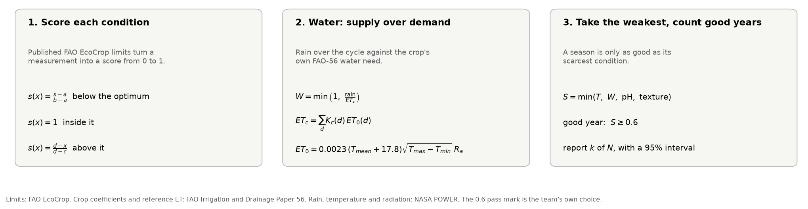
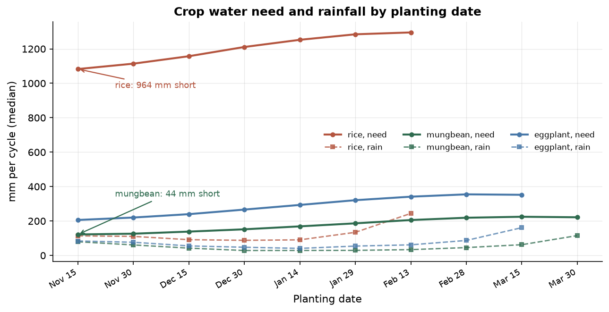
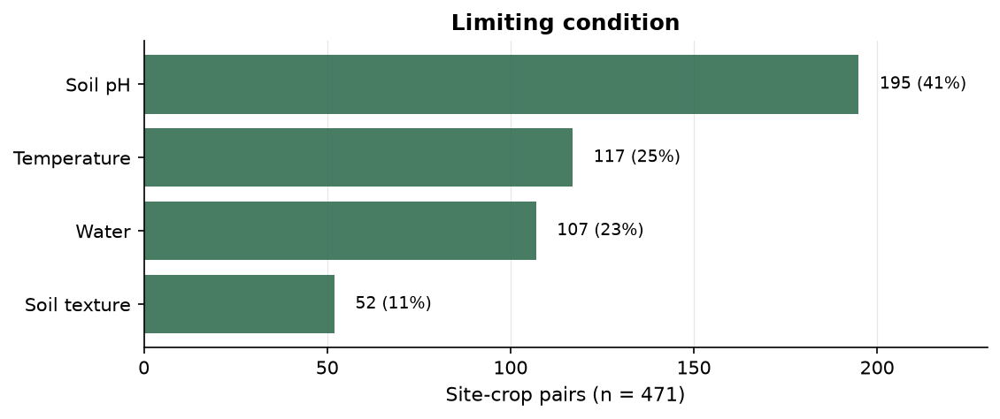

# AniNow Klima

NASA Space Apps Challenge 2026 · [Field Shift: Adapting Farms with NASA Data](https://www.spaceappschallenge.org/2026/challenges/field-shift-adapting-farms-with-nasa-data/) · Team AniNow

This page follows the Space Apps project form, field by field. The full write-up — data,
methods, results and limitations — is **[docs/Paper.md](docs/Paper.md)**.

---

## Project Name

**AniNow Klima** — what to plant after the rice harvest, from 44 seasons of NASA data

## Summary

AniNow Klima helps Filipino rice farmers decide what to plant after harvest: rice again,
or a rotation crop. Between the November harvest and the next planting, a field sits idle
for about 197 days in the driest part of the year. Our model replays 44 past seasons
(1981–2024) of daily NASA POWER weather for the farmer's own field and checks each of 29
crops against published FAO limits for temperature, water, soil pH and soil texture,
using measured Philippine soil samples and the FAO-56 crop water method. A season's score
is its weakest condition. The tool reports how many past seasons each crop would have had
what it needs, how much extra water it would have required, and why. Across 22 Philippine
sites a suitable crop exists at 17; the best alternative needs a median 573 mm less
irrigation than a second rice crop; and where the soil rules everything out, the tool
says "no suitable recommendation" instead of guessing. Nothing is a black box: the model
has no fitted parameters, every threshold is traced to a source, and its statistical
weaknesses are published alongside its results.

## Project Demonstration

`ADD LINK` — slides (7 at most) or a video (30 seconds at most), on a public link.

## Project

- Repository: https://github.com/GizaRoi/aninow-klima
- Live app: https://aninow-klima.vercel.app

## Project Details

### What it does

A farmer gives five answers: where the field is, when the rice was harvested, when the
next rice goes in, whether water stays on the field after rain, and whether there is
irrigation. AniNow Klima returns, for each of 29 crops:

- whether the crop fits the window and the field at all;
- in how many of the past seasons its published requirements were met, with a 95% range;
- how many millimetres of water it would have been short of in a typical season;
- which condition held it back — heat, water, soil pH or soil texture;
- the best date to plant.

### How it works



1. **Score each condition.** FAO EcoCrop publishes four limits for each crop and
   condition. Inside the optimal range the score is 1; it falls in a straight line to 0
   at the absolute limit.
2. **Score water as supply over demand.** Crop water need is built day by day with the
   FAO-56 method: reference evapotranspiration from NASA POWER temperature and radiation,
   times the crop's coefficient curve. The water score is rain divided by that need.
3. **Take the weakest, count the good years.** A season's suitability is its lowest
   score, so good soil cannot make up for missing water. A season at 0.6 or better is a
   good year, and the tool reports good years out of the seasons it could score.

```
S   = min(temperature, water, soil pH, soil texture)
W   = min(1, rain / ETc)
ETc = sum over the cycle of Kc(day) x ETo(day)
ETo = 0.0023 (Tmean + 17.8) sqrt(Tmax - Tmin) Ra        FAO-56 Eq. 52
```

Crops that cannot fit the window or the field's drainage are ruled out before any score
is computed. Nothing is trained or fitted: every number is a count or a median over past
seasons.

### What it found

| When to plant | Across 22 sites | Water saved |
|---|---|---|
| A second rice crop at the pilot field is **964 mm** short of water in a typical season. Mungbean is **44 mm** short. | A crop is suitable at **17 of 22** sites. At 5 the answer is "no suitable recommendation". | The best alternative needs less irrigation than rice at **all 22** sites: median **573 mm**, or 5,725 m³ per hectare. |
|  |  |  |

Pilot field, Science City of Muñoz, Nueva Ecija, rain only:

| Crop | Cycle | Good years | 95% range | Water short by |
|---|---|---|---|---|
| **Mungbean** (munggo) | 50 days | **22 of 41** | 39%–68% | **44 mm** |
| Eggplant (talong) | 70 days | 13 of 41 | 20%–47% | 115 mm |
| Tomato (kamatis) | 70 days | 13 of 41 | 20%–47% | 127 mm |
| Rice again (palay) | 106 days | 0 of 41 | 0%–9% | 964 mm |

### How far it can be trusted

| What limits a crop | The record is not one climate | El Niño |
|---|---|---|
| Soil pH limits more site-crop pairs (195) than water does (107). | Window rainfall rises at 21 of 22 sites, so a count over 41 years understates recent seasons. | Good years fall in El Niño seasons in 202 of 228 pairs, but only 25 are significant. We report the direction, not a proven effect. |
|  |  |  |

**There is no accuracy figure, because no harvest record exists for these fields.** We
do not report one. What we measure instead — uncertainty, independence of seasons,
trend, sensitivity to our own constants — is in [the paper](docs/Paper.md), Section 4.

### Benefits

- **Specific.** The answer is for one field, one soil and one window, not a region.
- **Explained.** Every result names the condition that limits the crop and the source of
  the limit.
- **Honest about not knowing.** A crop that cannot be judged is "not rated", not "not
  suited"; a field where nothing suits gets no recommendation.
- **Runs anywhere.** The model needs only the Python standard library and no internet.

### Intended impact

A second income from land that is otherwise idle for six months, chosen with less risk.
Less irrigation water spent on a crop the record says rarely gets enough. A tool an
extension worker can question line by line before repeating its advice to a farmer.

### Tools, languages and software

Python 3 (standard library) for the model, statistics and local form · matplotlib, NumPy
and pandas for figures · Jupyter notebook · FastAPI and Uvicorn on Render for the model
API · web front end on Vercel · Git and GitHub.

### How it is creative

It replays history instead of forecasting, so a farmer hears "in 22 of the last 41
seasons" rather than a probability nobody can check. It treats "we cannot tell" as a
result. And it publishes its own weaknesses — the constants we chose, the tests that
came back inconclusive — in the same place as its findings.

### Factors we considered

Whether a crop physically fits the 197-day window · drainage, from the farmer's own
answer · that EcoCrop rainfall limits are annual and cannot score one cycle · that missing
satellite data is not zero · that sites sharing a weather grid cell are not independent ·
that a number we chose ourselves must be labelled as ours.

## Use of Super Intelligence (SI)

AI assistants were used in building this project. On the model and analysis in this
repository they were used for:

- **Coding, debugging, or troubleshooting** — drafting and reviewing Python.
- **Writing, editing, or translation** — drafting and editing documentation.
- **Data analysis and interpretation** — assistance with the statistical scripts.
- **Research or information gathering** — locating published sources, which the team
  then read and archived in `model/sources/`.

The model itself contains **no AI or machine learning**. No image in this repository is
AI-generated: every figure is plotted by code from the model's output. All numbers are
produced by the committed code from the committed data and are covered by 170 automated
tests.

## NASA Data

| Link text | Link URL |
|---|---|
| NASA POWER (Prediction Of Worldwide Energy Resources) | https://power.larc.nasa.gov/ |
| NASA POWER Daily API | https://power.larc.nasa.gov/docs/services/api/temporal/daily/ |
| NASA POWER Methodology | https://power.larc.nasa.gov/docs/methodology/ |
| MERRA-2 reanalysis (source of POWER temperature, precipitation, soil wetness) | https://gmao.gsfc.nasa.gov/reanalysis/MERRA-2/ |
| CERES SYN1deg (source of POWER top-of-atmosphere irradiance) | https://ceres.larc.nasa.gov/ |

Parameters used: `T2M`, `T2M_MAX`, `T2M_MIN`, `PRECTOTCORR`, `GWETROOT`, `TOA_SW_DWN`;
daily, 1 January 1981 to 31 December 2025, at 22 points.

## Space Agency Partner & Other Data

| Link text | Link URL |
|---|---|
| NOAA Climate Prediction Center, Oceanic Niño Index | https://www.cpc.ncep.noaa.gov/data/indices/oni.ascii.txt |
| FAO EcoCrop, crop ecological requirements | https://ecocrop.apps.fao.org/ecocrop/srv/en/home |
| FAO Irrigation and Drainage Paper 56, Crop Evapotranspiration | https://www.fao.org/4/x0490e/x0490e00.htm |
| FAO Irrigation Water Management Training Manual 3 | https://www.fao.org/4/s2022e/s2022e07.htm |
| SARAI (UP Los Baños), measured soil samples | https://www.sarai.ph/ |
| Department of Agriculture, Indigenous Vegetables Guide | https://hvcdp.da.gov.ph/wp-content/uploads/2022/05/Indigenous-Vegetables-Guide.pdf |
| Department of Agriculture CAR, Organic Highland Vegetables Technoguide | https://hvcdp.da.gov.ph/wp-content/uploads/2022/05/DA-CAR-TECHNOGUIDE-IN-PRODUCTION-_-MANAGEMENT-OF-ORGANIC-HIGHLAND-VEGETABLES.pdf |
| PhilRice, Pinoy Rice Knowledge Bank, rice varieties | https://www.pinoyrice.com/rice-varieties/ |
| Bureau of Soils and Water Management, Philippine soil series (examined, not used) | https://www.bswm.da.gov.ph/download/philippine-soil-series/ |
| Python | https://www.python.org/ |
| Matplotlib | https://matplotlib.org/ |
| NumPy | https://numpy.org/ |
| pandas | https://pandas.pydata.org/ |
| FastAPI | https://fastapi.tiangolo.com/ |

---

## Repository

```
README.md        this page
docs/Paper.md    the write-up: data, methods, results, limitations, references
docs/figures/    all figures (PNG)
docs/analysis/   result tables (CSV) and the statistics behind them
notebooks/       klima_analysis.ipynb and the figure code
model/           the model, its input data, archived sources, tests, local form, API
demo/            offline demo page
```

Reproduce everything:

```bash
python model/klima_model.py                    # the pilot field
python model/analysis.py --out docs/analysis   # all 22 sites, all tables
python notebooks/make_figures.py               # all figures
cd model && python -m unittest test_klima_model test_serve test_expansion test_analysis test_trust_charts
```

The model needs nothing beyond Python. Figures need
`pip install -r notebooks/requirements.txt`; the API and its tests need
`pip install -r model/requirements-dev.txt`. Try the local form with
`python model/serve.py`.

More documentation is indexed in [docs/README.md](docs/README.md); development notes are
in [CONTRIBUTING.md](CONTRIBUTING.md).

Licence: see [LICENSE](LICENSE). NASA POWER data were obtained from the NASA Langley
Research Center POWER Project, funded through the NASA Earth Science/Applied Science
Program. Use of NASA data does not imply NASA endorsement.
