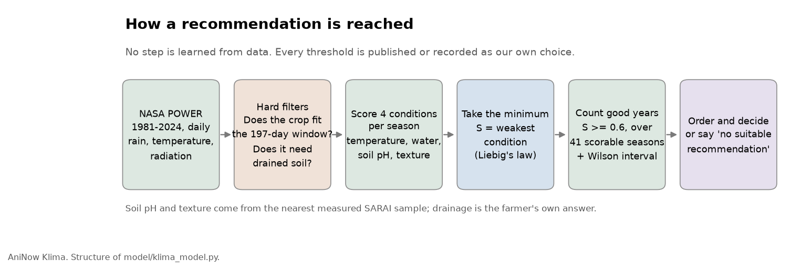
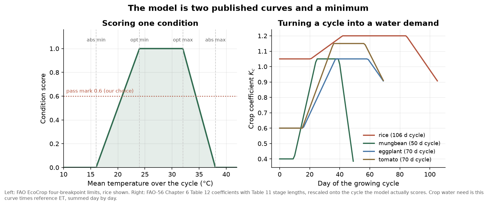
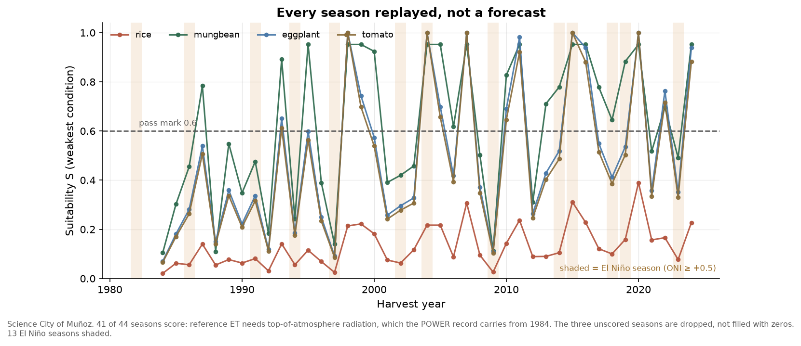
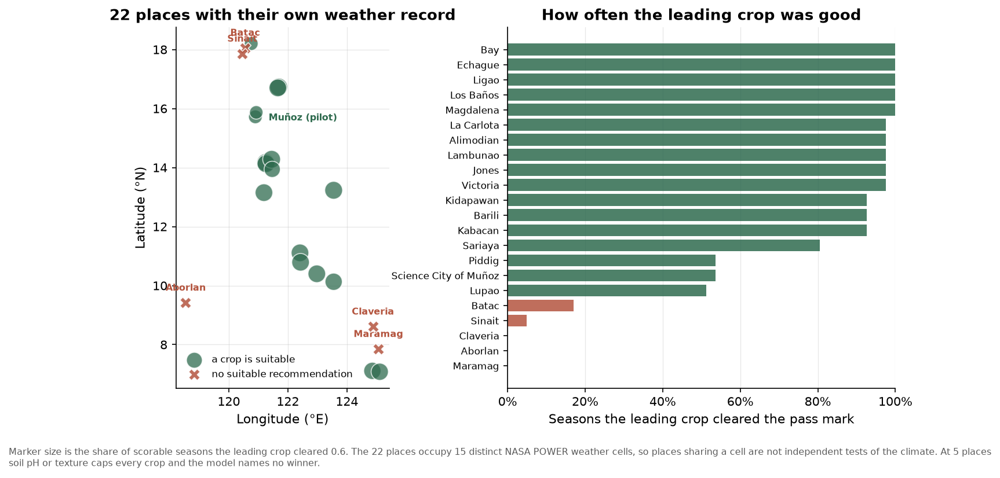
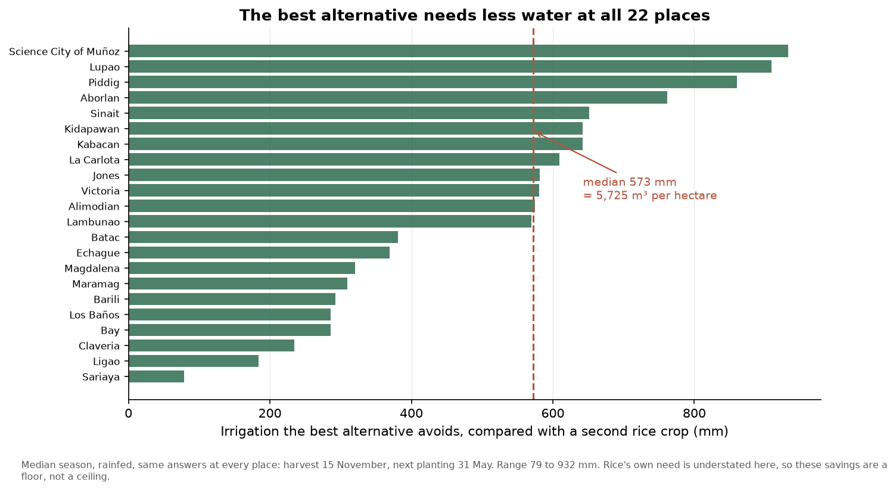
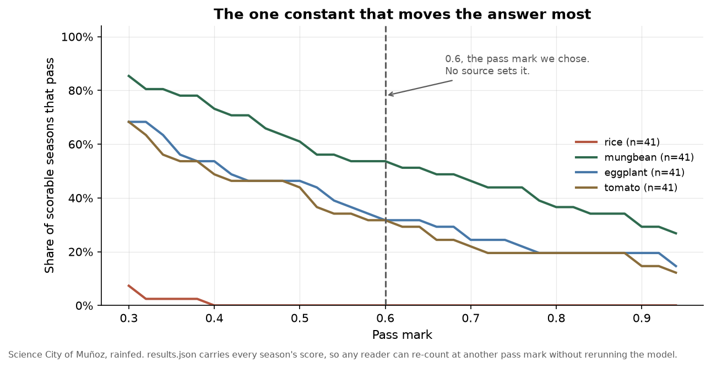
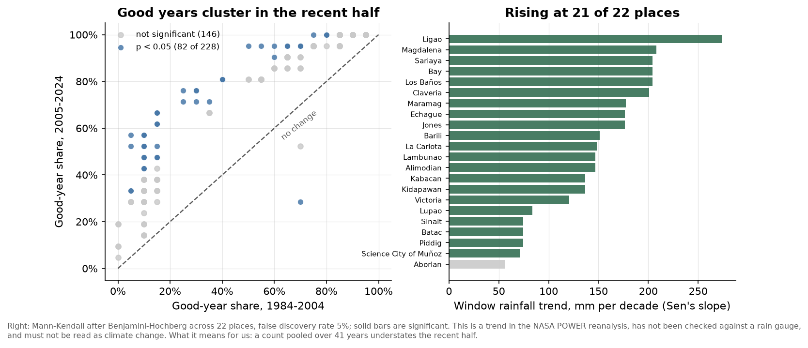
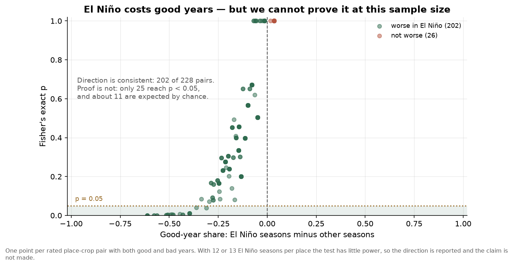

# AniNow Klima

**What should a Filipino rice farmer plant after the harvest — rice again, or something else?**
AniNow Klima answers that from 44 seasons of NASA Earth observation, published agronomic
limits, and the farmer's own field, and it shows its working.

Built for NASA Space Apps [Field Shift: Adapting Farms with NASA Data](https://www.spaceappschallenge.org/2026/challenges/field-shift-adapting-farms-with-nasa-data/).

**Status.** The decision model runs. `model/` scores **29 crops** at **22 places** from
Ilocos Norte to North Cotabato over 44 seasons of NASA POWER data, with a FAO-56 water
balance, measured soil from the nearest SARAI sample, a whole-schedule check, a local web
form, a diagnostics suite and a tested set of statistics. The pilot field at Muñoz, Nueva
Ecija (15.72 °N, 120.90 °E) is the one reviewed in detail. There is no web application,
database deployment or trained predictive model yet.

> **Every figure on this page is generated from the model's own output.** None of them
> illustrates what a result might look like. Regenerate them all with two commands —
> see [Running it](#running-it).

---

## The problem

A rice farmer in Central Luzon harvests in November and plants again at the end of May.
Between those dates the field sits idle for about **197 days**. Something could grow in
it, and for a smallholder that gap is the difference between one income and two.

Deciding what is not simple. The crop has to fit the calendar, survive the soil, and
above all be waterable: the dry months in that window bring 15–36 mm of rain a month
while a second rice crop needs over a thousand. Extension advice exists but is generic,
and the data that could localise it — decades of satellite weather, soil surveys, FAO crop
requirements — is spread across sources that do not talk to each other, in units a farmer
should never have to reconcile.

**The gap we found:** nothing puts a farmer's own field, a published crop requirement, and
forty-four years of local weather in the same sentence. That is the whole of what this
model does.

---

## How it decides



Six steps, and **no step is learned from data.** Hard feasibility comes first — a crop
that cannot physically fit the window is never scored — then four conditions are scored
per season, the weakest is taken, and good seasons are counted. Where nothing clears the
bar, the model says **"no suitable recommendation"** rather than naming the least bad
option.

---

## The model, in three formulas

The whole thing is small enough to read. Each condition is scored 0 to 1 from published
breakpoints, and a season's suitability is the **weakest** of the four:

$$S = \min\bigl(\text{temperature},\ \text{water},\ \text{soil pH},\ \text{soil texture}\bigr)$$

The minimum, not an average — a crop is only as well served as the thing it is shortest
of. This is Liebig's law of the minimum, the rule FAO EcoCrop's own model applies. An
average would let good soil pay for absent water.

Water is the only one of the four that changes from season to season. It is **relative
water supply**: rain over the cycle against the crop's own demand, capped at 1.

$$W = \min\left(1,\ \frac{\text{rain over the cycle}}{ET_c}\right),
\qquad ET_c = \sum_{i} K_c(i)\, ET_0(i) \;+\; n \cdot P_{\text{seepage}}$$

Demand is built day by day from FAO-56: a reference evapotranspiration from temperature
and top-of-atmosphere radiation, scaled by the crop's coefficient curve through four
growth stages.

$$ET_0 = 0.0023\,(T_{\text{mean}} + 17.8)\,\sqrt{T_{\max} - T_{\min}}\;R_a$$

A season is a **good year** when $S \ge 0.6$. Both curves below are published; the 0.6 is
ours, and [§11 of the mathematics](docs/Model-Mathematics.md) lists every other constant
we chose rather than sourced.



**Left:** four numbers from the crop's EcoCrop sheet become a score — 1 inside the optimal
range, falling in a straight line to 0 at the absolute limit. No margin in that shape is
ours, which is why it can be checked against the source. **Right:** FAO-56 Table 12
coefficients on Table 11 stage lengths, rescaled onto the cycle the model actually uses.

Full derivation, with every absence rule and every chosen constant:
**[docs/Model-Mathematics.md](docs/Model-Mathematics.md)**.

---

## What it says

### When to plant, and why the answer is "now"


The gap between a solid line and its dashed partner is water somebody has to supply.
A second rice crop planted on harvest day needs **1,083 mm** and gets **114 mm** of rain —
**964 mm short**. Mungbean, on the same day, is **44 mm short**. That is a factor of
twenty-two, and it is the whole recommendation.

Planting later catches more rain, but reference ET climbs from 3.25 mm/day in November to
6.02 mm/day in April and the heat-stressed days multiply. Planting straight after harvest
has both the smallest shortfall and no heat-stressed days — which is also what farmers
already do, so the model arrives at established practice from the data rather than
contradicting it.

### The pilot field, crop by crop

The farmer answers that water drains off the field and there is no irrigation.

| Crop | Cycle | Suitability | Seasons passing | 95% interval | Water short by |
|---|---|---|---|---|---|
| **Mungbean** (munggo) | 50 d | **0.64** | **22 of 41** | 39%–68% | **44 mm** |
| Eggplant (talong) | 70 d | 0.42 | 13 of 41 | 20%–47% | 115 mm |
| Tomato (kamatis) | 70 d | 0.39 | 13 of 41 | 20%–47% | 127 mm |
| Rice again (palay) | 106 d | 0.11 | 0 of 41 | 0%–9% | 964 mm |

Suitability is the crop's weakest condition in a typical season. At this field that is
always water, so 0.64 means rain covered 64% of what mungbean needed.

Counts are out of 41, not 44: reference ET needs a radiation record that starts in 1984,
so the 1981–1983 seasons have no water score and are **left out rather than counted as
passes**. With all 29 crops rated, mungbean shares the top of the pilot's list with
labanos (radish) — 22 of 41 good years each — and remains the leading legume.

### Every season replayed, not a forecast



Each point is one real past season scored on that season's own weather. Shaded bands are
El Niño seasons. **These are historical frequencies, not probabilities of success.**

### Across 22 places



- **At 17 of 22 places at least one crop is suitable.** Mungbean leads at 6, labanos at 4,
  paayap (cowpea) at 3, and snap bean, squash, rice and sweet sorghum at one each.
- **At 5 places the answer is "no suitable recommendation"** — Batac, Maramag, Sinait,
  Aborlan, Claveria. Soil pH or clay caps every crop there.
- **Soil, not water, is the commonest limit.** Across every rated place and crop the
  weakest condition is soil pH in 195 pairs, temperature in 117, water in 107, texture in 52.



**The best alternative needs less water than a second rice crop at all 22 places** —
median 573 mm, which is 5,725 cubic metres per hectare. Rice's own demand is understated
here (FAO Training Manual 3's saturation and standing-water layer are not included), so
that saving is a floor.

---

## How far the numbers can be trusted

The arithmetic is verified: reference ET reproduces an independent hand calculation to the
decimal across seven months, crop water demand agrees with FAO's published per-cycle
figures, and **170 tests** cover the farmer-facing inputs, the statistics, and every
EcoCrop number against its saved source sheet.

The statistics are weaker than the arithmetic, and we would rather say so here than have a
judge find it.

### What actually decides the answer


Because $S$ is a minimum it reports only the binding condition. If one bar held every
pair, this model would be a single-variable calculator wearing four names. It does not —
but at a well-watered, neutral-pH site the other three all score 1.00 and $S$ *is* the
water score exactly. That degeneracy is real and is stated rather than hidden.

### The one constant that moves the answer most



**The 0.6 pass mark is ours and no source sets it.** Mungbean leads at every mark from 0.4
to 0.8, so the mark changes how many seasons count as good, not which crop comes first —
but `results.json` carries every season's score so any reader can re-count at another
threshold without rerunning the model.

### The record is not one climate



Window rainfall rises at **21 of 22 places** (Mann-Kendall with Benjamini-Hochberg at 5%
false discovery rate). So a count pooled over 41 years **understates the recent half** —
quoting "22 of 41" to a farmer deciding for 2026 is pessimistic. This is a trend in the
NASA POWER reanalysis, has not been checked against a rain gauge, and **is not presented
as evidence of climate change.**

### An honest negative result



El Niño lowers the good-year share in **202 of 228** place-crop pairs — the expected
direction, consistently. But only **25** reach p < 0.05, and about 11 would be expected by
chance alone. With 12 or 13 El Niño seasons per place the test has little power. **The
direction is reported; the claim is not made.**

### Three more, in the detailed set

- **The rainfall input disagrees with itself.** POWER's two precipitation columns correlate
  at r = 0.745 but `PRECTOTCORR` reads **19% lower**, and that spread passes straight into
  every shortfall. It is also not yet an IMERG cross-check: POWER's header labels that
  column MERRA-2.
- **Seasons are not independent draws.** Mungbean's lag-1 autocorrelation is +0.142, giving
  it an effective sample of **31 rather than 41**, so its 95% interval is a little too narrow.
- **What the inputs cover.** `-999` is read as missing, never as zero and never averaged in.

## What cannot be claimed at all

There is **no validation against crop outcomes**, because no harvest record exists for
these fields. Accuracy, precision, recall, ROC and any "model performance" figure are
unavailable, and presenting one would be the most damaging thing this project could do.
A test in the suite fails if any chart caption so much as contains one of those words.

Nor can this model offer a forecast for next season, a yield, an income, or a claim to
"cover the Philippines" — it covers the 22 places listed, in 15 distinct weather cells,
and places sharing a cell are not independent tests of the climate.

---

## Running it

```bash
cd model
python klima_model.py --help          # every farmer answer it accepts
python klima_model.py                 # the pilot's answers
python klima_model.py --drainage poorly_drained
python klima_model.py --soil-ph 4.8 --soil-texture heavy
python diagnostics.py                 # the checks
python sensitivity.py                 # how far the chosen crop values move the answer
python insights.py                    # every place, side by side
python serve.py                       # a local form at 127.0.0.1:8000
python analysis.py --out ../docs/analysis   # tables and statistics for the pitch
python -m unittest test_klima_model test_serve test_expansion test_analysis test_trust_charts -v
```

The model and local form use the **standard library only** — no NumPy, no matplotlib, no
internet at run time.

Regenerating every figure on this page takes two commands:

```bash
python model/analysis.py --out docs/analysis
python notebooks/make_figures.py
```

Figures need `pip install -r notebooks/requirements.txt` (matplotlib, numpy, pandas). The
same code renders inline in **[notebooks/klima_analysis.ipynb](notebooks/klima_analysis.ipynb)**,
which walks the method end to end.

The HTTP comparison API adds FastAPI and Uvicorn. From `model/`, in a virtual environment,
`pip install -r requirements-dev.txt`, then
`python -m uvicorn api:app --host 127.0.0.1 --port 8000 --workers 1` and open `/docs`.
See [the API and deployment guide](docs/Model-API.md).

---

## All the figures

The ten above are the curated set. Everything else is kept and reachable.

| Set | What it is | Index |
|---|---|---|
| **Notebook figures** (10, PNG) | The set on this page | [`docs/figures/`](docs/figures/) · [notebook](notebooks/klima_analysis.ipynb) |
| **Method and diagnostics** (11, SVG) | Pipeline, scoring function, coefficient curve, input coverage, rainfall cross-check, intervals at effective *n* | [`docs/images/`](docs/images/) |
| **Trust and credibility** (8, SVG) | What decides the answer, season independence, the texture stand-in's cost, limiting-factor margin | [`docs/images/trust/index.html`](docs/images/trust/index.html) |
| **Pitch set** (9, SVG + PNG) | Slide-shaped versions for the presentation | [`docs/pitch/index.html`](docs/pitch/index.html) |

Full tables behind every number: **[docs/analysis/pitch_stats.md](docs/analysis/pitch_stats.md)**
(22 places, 29 crops, seven named statistical treatments) with
[`places.csv`](docs/analysis/places.csv), [`crops.csv`](docs/analysis/crops.csv),
[`crop_by_place.csv`](docs/analysis/crop_by_place.csv) and
[`seasons.csv`](docs/analysis/seasons.csv) beside it.

## Documentation

- **[Handoff](docs/HANDOFF.md)** — what exists now, what changed, and what is open
- **[Model mathematics](docs/Model-Mathematics.md)** — the whole model as one function, every constant attributed
- **[Model narrative](docs/Model-Narrative.md)** — the method, the results, the problems, and the units error that shaped the model
- **[Pitch statistics](docs/analysis/pitch_stats.md)** — every place and crop, with the statistical treatments
- [Model explained step by step](docs/Model-Explained.md) — every formula worked by hand
- [Audit and decision checklist](docs/Audit-and-Decision-Checklist.md) — findings, changes, and open decisions
- [Model comparison API and deployment](docs/Model-API.md)
- [Review of the rotation-timing branch](docs/Romano-Branch-Review.md)
- [Documentation index and implementation defaults](docs/README.md)
- [Product requirements](docs/AniNow-Klima-PRD.md) · [Decision rules](docs/Decision-Engine-Spec.md) · [Roadmap](docs/MVP-Roadmap.md) · [Resources and evidence](docs/Resources-and-Evidence.md)

See [CONTRIBUTING.md](CONTRIBUTING.md) for the repository layout, the conventions the
numbers depend on, and what is known to be wrong.

## Data and licence

NASA POWER (daily agroclimatology, 1981–2025) · NOAA CPC Oceanic Niño Index · FAO EcoCrop
crop requirements · FAO Irrigation and Drainage Paper 56 · FAO Irrigation Water Management
Training Manual 3 · UPLB SARAI soil samples · Philippine Department of Agriculture regional
crop guides · PhilRice / Pinoy Rice Knowledge Bank varietal data.

See [LICENSE](LICENSE). Dataset permissions and attribution are tracked separately; use of
NASA data does not imply NASA endorsement.
