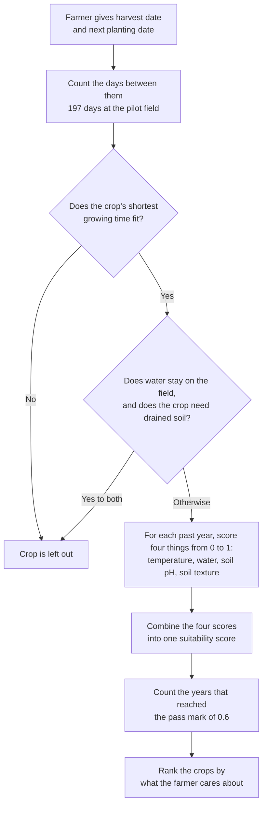
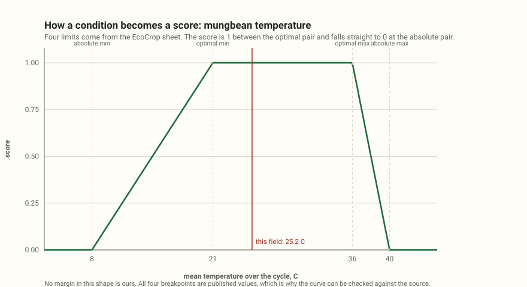
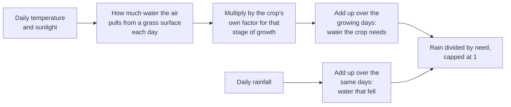
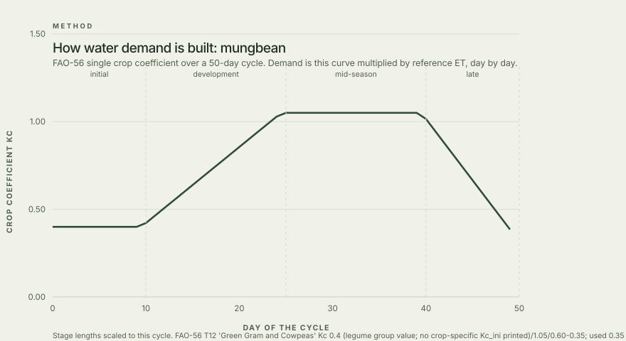
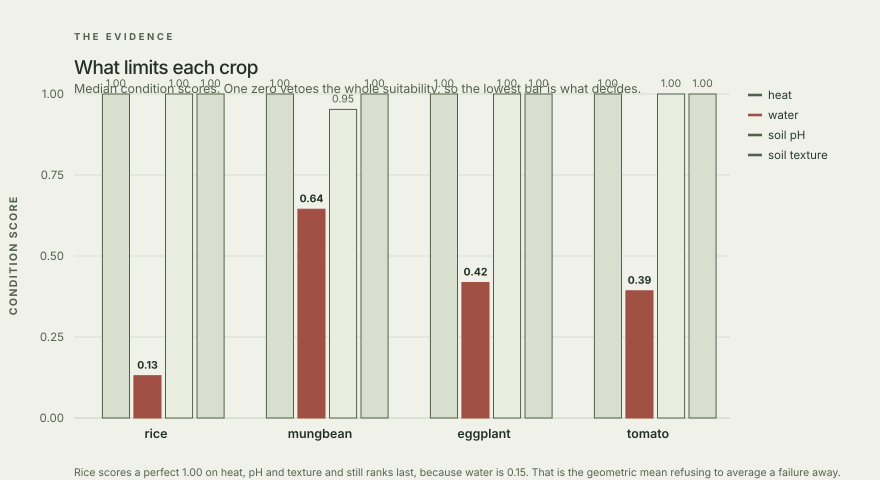
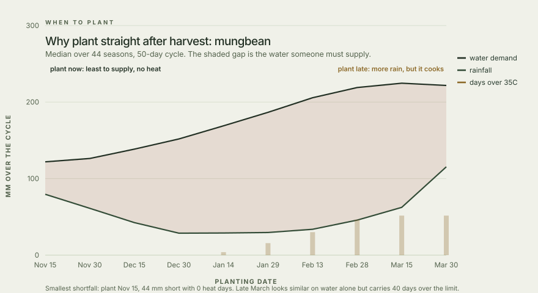

# How the AniNow Klima model works: a worked guide

Pilot field: Science City of Muñoz, Nueva Ecija. Record used: 1981 to 2024. Model revision: 2026-11-15.

This guide is for a reader who has never seen the model. It explains each step in plain
words, gives the formula, and then works one real example by hand so the result can be
checked with a calculator. Every number comes from `model/klima_model.py` run on the
committed data. Where an example is made up to show how a formula behaves, it says so.

For the charts on reliability and the full list of caveats, read
[Model-Narrative.md](Model-Narrative.md). For the audit and open decisions, read
[Audit-and-Decision-Checklist.md](Audit-and-Decision-Checklist.md).

---

## Abstract

After the rice harvest, a field in Muñoz sits unused for about 197 days until the next rice
planting. The model asks what could be grown in that time. It compares four crops (rice
again, mungbean, eggplant, tomato) against the past 44 years of NASA weather data and one
measured soil sample. For each crop and each past year it works out four scores between 0
and 1, for temperature, water, soil pH and soil texture, and combines them into one
suitability score. It then counts how many past years reached a set mark.

On a rainfed field that drains well, mungbean comes first. Planted right after harvest, a
50-day mungbean crop needed about 44 mm of water beyond rainfall in a typical year, against
752 mm for a 106-day rice crop. The model describes how past years went. It does not
forecast next season, and it has not been checked against real harvests.

---

## 1. The question

A farmer harvests rice in mid-November and plants rice again at the end of May. Between
those two dates the field is empty. Three things can happen: leave it empty, plant rice a
second time, or plant something else.

The model answers one narrow question:

> In past years, how well did this field meet what each crop needs, and how much extra
> water would the farmer have had to supply?

It does not answer what the yield will be, what the crop will sell for, or what the weather
will do next year.

## 2. What goes in

| Input | Where it comes from | What it gives |
|---|---|---|
| Daily weather, 1981–2025 | NASA POWER | Temperature (mean, highest, lowest), rainfall, sunlight at the top of the atmosphere, root-zone wetness |
| Crop limits | FAO EcoCrop | The temperature, soil pH and soil texture each crop tolerates, and how many days mungbean, eggplant and tomato take to grow |
| Rice growing time | Pinoy Rice Knowledge Bank (PhilRice) | Days to maturity of NSIC Rc222, a variety widely planted in Nueva Ecija: 106 days direct seeded, 114 transplanted |
| Crop water use | FAO Irrigation and Drainage Paper 56 ("FAO-56") | How much water each crop uses at each growth stage |
| Soil | SARAI soil samples | pH and texture from the nearest measured sample (3.44 km from the pilot field) |
| El Niño record | NOAA Niño 3.4 index | Which past years were El Niño years |
| The farmer | The form | Harvest date, next planting date, whether water stays on the field, whether there is irrigation, what matters most |

Missing weather values are stored in the NASA file as `-999`. The model reads these as
"no data", never as zero.

## 3. The method at a glance



The rest of this guide takes these boxes one at a time.

## 4. Step 1: how long the field is empty

The window runs from the harvest date to the day before the next planting.

**Worked example.** Harvest on 15 November, next planting on 31 May. The last free day is
30 May.

| Month | Days counted |
|---|---|
| November (15th to 30th) | 16 |
| December | 31 |
| January | 31 |
| February | 28 |
| March | 31 |
| April | 30 |
| May (1st to 30th) | 30 |
| **Total** | **197** |

In a leap year February has 29 days and the window is 198. The model uses the shorter
figure, 197, so that a crop has to fit in every year.

The same two dates are then applied to every year from 1981 to 2024. That gives 44 past
seasons to test against.

## 5. Step 2: two checks that can rule a crop out

These run before any scoring. A crop that fails either one is listed as not suitable and
is never scored or ranked.

**Check 1: does it fit?** The crop's shortest growing time must be no longer than the
window.

| Crop | Shortest growing time | Window | Fits? |
|---|---|---|---|
| Rice | 106 days | 197 days | Yes |
| Mungbean | 50 days | 197 days | Yes |
| Eggplant | 70 days | 197 days | Yes |
| Tomato | 70 days | 197 days | Yes |

**Check 2: drainage.** If the farmer says water stays on the field for days after rain,
any crop that needs drained soil is ruled out. Mungbean, eggplant and tomato all need
drained soil. Rice does not. So on a field that holds water, only rice is left.

If the farmer answers "not sure", nothing is ruled out, but each result carries a note
that drainage has not been confirmed.

## 6. Step 3: turning a measurement into a score

Each crop's data sheet gives four numbers for a condition such as temperature:

- the lowest value the crop survives,
- the lowest value at which it grows well,
- the highest value at which it grows well,
- the highest value it survives.

The score is 1 anywhere in the "grows well" range, 0 outside the "survives" range, and
falls in a straight line in between.



Written out, with `a` and `d` as the survival limits and `b` and `c` as the grows-well
limits:

```
score = 0                    if x is below a or above d
score = (x − a) / (b − a)    if x is between a and b
score = 1                    if x is between b and c
score = (d − x) / (d − c)    if x is between c and d
```

### 6.1 Temperature

The measurement is the average air temperature over the crop's growing days.

**Worked example (real).** Mungbean planted 15 November 2010, 50 days. Average temperature
was 24.8 °C. Mungbean's limits are 8, 21, 36 and 40 °C. Since 24.8 lies between 21 and 36,
the score is **1.00**.

**Worked example (made up, to show the slope).** If the average had been 18 °C:

```
score = (18 − 8) / (21 − 8) = 10 / 13 = 0.77
```

At Muñoz the average over a growing period has stayed between 23.1 and 27.6 °C in every
year on record. That is inside the grows-well range of all four crops, so temperature
scores 1.00 every time. It never separates the crops at this site.

### 6.2 Soil pH

Same rule, using the soil sample's pH of 6.3.

**Worked example (real).** Mungbean's pH limits are 4.3, 5.5, 6.2 and 8.3. A pH of 6.3 is
just above the grows-well range, so it falls on the right-hand slope:

```
score = (8.3 − 6.3) / (8.3 − 6.2) = 2.0 / 2.1 = 0.95
```

| Crop | Grows well at pH | Field pH | Score |
|---|---|---|---|
| Rice | 5.5 to 7.0 | 6.3 | 1.00 |
| Mungbean | 5.5 to 6.2 | 6.3 | 0.95 |
| Eggplant | 5.5 to 6.8 | 6.3 | 1.00 |
| Tomato | 5.5 to 6.8 | 6.3 | 1.00 |

### 6.3 Soil texture

Texture is a category, not a number, so it gets a simpler rule. The sample's texture name
is first sorted into one of three groups:

| Group | Texture names |
|---|---|
| Light | sand, loamy sand, sandy loam |
| Medium | loam, silt, silt loam, clay loam, silty clay loam, sandy clay loam |
| Heavy | clay, silty clay, sandy clay |

Then:

- **1.0** if the crop's data sheet lists that group as ideal,
- **0.5** if the sheet lists it only as tolerated,
- **0** if it is not listed at all.

The pilot sample is loam, which is medium. All four crops list medium as ideal (rice lists
all three), so every crop scores **1.00**.

The 1 / 0.5 / 0 steps are the team's own choice. No source gives them.

## 7. Step 4: the water score

Water is the only condition that changes much from year to year at this field, so it
decides almost everything. It takes four small steps.



### 7.1 How thirsty the air is

On a hot, sunny day, water leaves soil and leaves faster. Agronomists measure this with
**reference evapotranspiration**, written ETo: the depth of water, in millimetres, that a
well-watered grass surface loses in one day.

The model uses the Hargreaves formula (FAO-56, Equation 52), which needs only temperature
and sunlight:

```
ETo = 0.0023 × (Tmean + 17.8) × √(Tmax − Tmin) × Ra
```

`Ra` is the sunlight reaching the top of the atmosphere, expressed in millimetres of water
it could evaporate. NASA reports it as energy (MJ per square metre per day); multiplying
by 0.408 converts it.

**Worked example (real).** 1 December 2015 at Muñoz:

| Reading | Value |
|---|---|
| Mean temperature | 26.44 °C |
| Highest temperature | 31.74 °C |
| Lowest temperature | 22.28 °C |
| Sunlight at top of atmosphere | 28.69 MJ/m²/day |

```
Ra  = 28.69 × 0.408                    = 11.71 mm/day
Tmean + 17.8 = 26.44 + 17.8            = 44.24
√(Tmax − Tmin) = √(31.74 − 22.28) = √9.46 = 3.076

ETo = 0.0023 × 44.24 × 3.076 × 11.71   = 3.66 mm/day
```

So on that day the air could take about 3.7 mm of water from a grass surface. The model's
own figure is 3.663.

The sunlight record starts in 1984. The 1981, 1982 and 1983 seasons therefore have no ETo,
no water score, and are left out of every count on a rainfed field. That is why the counts
below are out of 41 and not 44.

### 7.2 How thirsty the crop is

A crop does not use water like grass. A seedling uses much less; a crop in full leaf uses
about the same or a little more. FAO-56 gives each crop a multiplier called the **crop
coefficient**, Kc, which changes through four stages.



For mungbean, FAO-56 lists:

| Stage | Length in FAO-56 | Kc |
|---|---|---|
| Early (seedling) | 20 days | 0.40 |
| Growing | 30 days | rises from 0.40 to 1.05 |
| Full size | 30 days | 1.05 |
| Ripening | 20 days | falls from 1.05 to 0.35 |

That adds to 100 days. For a 50-day crop the model keeps the same proportions and halves
each stage:

| Day of the crop | Stage | Kc |
|---|---|---|
| 1 to 10 | Early | 0.40 |
| 11 to 25 | Growing | 0.42 rising to 1.03 |
| 26 to 40 | Full size | 1.05 |
| 41 to 50 | Ripening | 1.02 falling to 0.39 |

The average Kc over the 50 days is 0.75.

Each day's crop water use is that day's ETo times that day's Kc. Summed over the growing
days it is called ETc, the crop's water need:

```
ETc = Kc(day 1) × ETo(day 1) + Kc(day 2) × ETo(day 2) + … + Kc(last day) × ETo(last day)
```

For rice only, 4 mm is added for every day to cover water that drains down through a
flooded paddy.

### 7.3 Rain against need

Rainfall over the same days is added up, then divided by the need:

```
water score = rain ÷ ETc      (never more than 1)
shortfall   = ETc − rain      (never less than 0)
```

A score of 1 means rain covered all of the crop's need. A score of 0.5 means it covered
half. The shortfall is the water, in millimetres, that would have to come from somewhere
else.

One millimetre of water over one hectare is 10 cubic metres, or 10,000 litres.

**Worked example (real).** Mungbean planted 15 November 2010, 50 days:

| Quantity | Value |
|---|---|
| ETo added over 50 days | 150.1 mm |
| ETc, the crop's need | 113.1 mm |
| Rain over the same 50 days | 93.6 mm |

```
water score = 93.6 ÷ 113.1 = 0.83
shortfall   = 113.1 − 93.6 = 19.5 mm
```

Rain covered 83% of what the crop needed. The remaining 19.5 mm is 195 cubic metres per
hectare.

**The same year for rice**, 106 days from the same date:

```
ETc  = 830.1 mm        rain = 149.2 mm
water score = 149.2 ÷ 830.1 = 0.18
shortfall   = 830.1 − 149.2 = 680.8 mm
```

Rice needed more than seven times as much water. It is in the field twice as long, and
about half of its need is the 4 mm a day that drains through the paddy. Rain covered less
than a fifth of it.

### 7.4 If the field is irrigated

Water is not scored at all, on the assumption that irrigation covers it. The shortfall is
still worked out and shown, because on an irrigated field that figure is the amount of
irrigation the crop will ask for.

## 8. Step 5: one score from four

The four scores are combined with a **geometric mean**: multiply them together and take
the fourth root.

```
suitability = (temperature × water × pH × texture) ^ (1/4)
```

If any one score is zero, the result is zero. This is deliberate. With an ordinary
average, a crop that cannot survive the heat could still score 0.75 because the soil suits
it.

**Worked example (real).** Mungbean, 2010 season:

```
temperature = 1.00    water = 0.83    pH = 0.95    texture = 1.00

product     = 1.00 × 0.83 × 0.95 × 1.00 = 0.788
suitability = 0.788 ^ (1/4)             = 0.94
```

**Three real seasons side by side** (planted 15 November, shortest growing time):

| Season | Crop | Rain | Need | Water score | Suitability |
|---|---|---|---|---|---|
| 2015 | Mungbean | 317 mm | 124 mm | 1.00 | 0.99 |
| 2010 | Mungbean | 94 mm | 113 mm | 0.83 | 0.94 |
| 1997 | Mungbean | 20 mm | 146 mm | 0.14 | 0.60 |
| 2015 | Rice | 336 mm | 869 mm | 0.39 | 0.79 |
| 2010 | Rice | 149 mm | 830 mm | 0.18 | 0.65 |
| 1997 | Rice | 29 mm | 947 mm | 0.03 | 0.42 |

Notice how the fourth root softens a low water score. In 1997 rain covered only 14% of
mungbean's need, yet suitability came out at 0.60, because the other three scores were all
at or near 1. This matters for the next step and is discussed in
[section 12](#12-what-to-keep-in-mind).

### 8.1 Farmer priorities

The farmer can say what matters most. Only one of the four choices changes the score
itself: **saving water** counts the water score three times.

```
suitability (saving water) = (temperature × water³ × pH × texture) ^ (1/6)
```

**Worked example (real).** Rice, 2010 season. Temperature, pH and texture are all 1.00, so
only water remains:

```
balanced:      0.18 ^ (1/4) = 0.65
saving water:  0.18 ^ (3/6) = 0.42
```

The same season drops from 0.65 to 0.42 once water is given more weight.

## 9. Step 6: counting the years

One year's score says little. The useful figure is how often the crop did well over many
years.

A year **passes** if its suitability is 0.6 or more. The 0.6 is called the pass mark. It
is the team's choice, not a published figure.

| Crop | Shortest growing time | Typical suitability | Years passed | Typical shortfall |
|---|---|---|---|---|
| Mungbean | 50 days | 0.89 | 38 of 41 | 44 mm |
| Eggplant | 70 days | 0.80 | 37 of 41 | 115 mm |
| Tomato | 70 days | 0.79 | 37 of 41 | 127 mm |
| Rice | 106 days | 0.60 | 21 of 41 | 752 mm |

"Typical" here means the median: the middle value when all the years are lined up in
order.

### 9.1 Dry years and El Niño years

The same count is repeated for two harder groups of years.

- **Dry years** are the nine years with the least rain in the window (the driest fifth of
  44). They are 1982, 1983, 1984, 1986, 1990, 1991, 1992, 1994 and 2009. Two of them, 1982
  and 1983, have no water score, which leaves seven.
- **El Niño years** are those where the Niño 3.4 sea-temperature reading, averaged over the
  months of the window, is 0.5 °C or more above normal. There are 13; one of them, 1982,
  has no water score, which leaves 12.

| Crop | All years | Dry years | El Niño years |
|---|---|---|---|
| Mungbean | 38 of 41 | 5 of 7 | 11 of 12 |
| Eggplant | 37 of 41 | 4 of 7 | 10 of 12 |
| Tomato | 37 of 41 | 4 of 7 | 10 of 12 |
| Rice | 21 of 41 | 0 of 7 | 4 of 12 |

Rice did not pass in any dry year.

### 9.2 How sure the count is

Thirty-eight out of 41 is 93%. But 41 years is a small sample, and a different set of 41
years would give a slightly different answer. The **Wilson interval** gives a range that
the long-run share probably lies in.

```
p      = passes ÷ years
centre = (p + z²/2n) ÷ (1 + z²/n)
spread = z × √( p(1 − p)/n + z²/4n² ) ÷ (1 + z²/n)
range  = centre − spread   to   centre + spread
```

with `n` the number of years and `z = 1.96` for a 95% range.

**Worked example (real).** Mungbean, 38 passes in 41 years:

```
p      = 38 ÷ 41                          = 0.9268
z²     = 1.96²                            = 3.8416
z²/n   = 3.8416 ÷ 41                      = 0.0937

centre = (0.9268 + 0.0937/2) ÷ 1.0937
       = 0.9737 ÷ 1.0937                  = 0.890

inside the root:
  p(1 − p)/n = 0.9268 × 0.0732 ÷ 41       = 0.001655
  z²/4n²     = 3.8416 ÷ (4 × 1681)        = 0.000571
  sum                                     = 0.002226
  root                                    = 0.0472

spread = 1.96 × 0.0472 ÷ 1.0937           = 0.085

range  = 0.890 − 0.085  to  0.890 + 0.085 = 0.81 to 0.97
```

So the honest way to state the result is "38 of 41 years, likely somewhere between 81% and
97% in the long run". For rice, 21 of 41 gives 36% to 66%. For the dry years the samples
are tiny (seven years), so the ranges are very wide: mungbean's 5 of 7 gives 36% to 92%.

## 10. Step 7: ranking

The order shown to the farmer depends on the priority they picked.

| Priority | Crops are ordered by | Ties are broken by |
|---|---|---|
| Overall fit | Most years passed | Higher typical suitability |
| Saving water | Most years passed, with water counted three times | Smaller typical shortfall |
| Healthier soil | Legumes first (mungbean is the only one) | Higher typical suitability |
| Finishing early | Shortest growing time | Higher typical suitability |

Crops ruled out in Step 2 are listed last with the reason and are never ranked.

At the pilot field all four priorities give the same order: mungbean, eggplant, tomato,
rice. That is because three of the four scores never change here (see below), so water
decides every ranking.

## 11. What the model says for the pilot field



Temperature, pH and texture are at or near 1.00 for every crop. Water is the low bar on
every one. The crops differ only in how much water they need.



The model also tries planting dates every 15 days through the window. Planting right after
harvest, on 15 November, gives the smallest shortfall for every crop. The soil is still
moist then, the air is cooler, and none of the growing days go above 35 °C. A crop planted
in late March catches more rain in May but spends most of its life in the hottest, driest
weeks of the year.

## 12. What to keep in mind

**The model has not been checked against real harvests.** No yield records exist for this
field. So there is no accuracy figure, and none should be quoted.

**"Passed" is a low bar for water.** Because the fourth root softens a low water score, a
year can pass with rain covering as little as 13% to 14% of the crop's need, as mungbean
did in 1997. The count of years passed should be read as "years that were not a disaster",
not "years with enough rain". The water score and the shortfall in millimetres say more.

**Rain is not all usable, and the soil is not empty at the start.** The model counts every
millimetre of rain as available to the crop and assumes no water is stored in the soil at
planting. Both are simplifications that pull in opposite directions. After a rice harvest
the soil usually holds a good deal of moisture, which is exactly what a short crop like
mungbean lives on.

**Some crop numbers were chosen, not read off a table.** FAO-56 leaves cells blank or
gives a range for several values. The model records each choice in `crops.csv`:

| Value | What FAO-56 gives | What the model uses |
|---|---|---|
| Mungbean early-stage Kc | Nothing specific for the crop | 0.40, the figure for legumes as a group |
| Eggplant and tomato early-stage Kc | Nothing specific for the crop | 0.60, the figure for the tomato family |
| Rice late-stage Kc | A range, 0.60 to 0.90 | 0.90 |
| Tomato late-stage Kc | A range, 0.70 to 0.90 | 0.90 |
| Mungbean late-stage Kc | A range, 0.35 to 0.60 | 0.35, the value for a crop harvested dry |
| Stage lengths, all but rice | Mediterranean, arid or Californian plantings only | Those lengths, scaled to the growing time |
| Growing time, all but rice | No local figure found yet | The span on the EcoCrop sheet, which covers every variety worldwide |
| Texture score steps | Not in any source | 1.0, 0.5, 0 |
| Pass mark | Not in any source | 0.6 |
| Dry-year share | Not in any source | Driest 20% |

**One place, four crops.** All of the weather is for a single NASA grid square, roughly 50
km across, and the soil is one sample. The results describe the pilot field. Other towns
need their own weather download, and other crops need their own rows of sourced limits.

**The climate has shifted.** Window rainfall has risen by about 70 mm per decade over the
record. Rice passed in 7 of the first 20 scored years and 14 of the last 21. A single
count for the whole record mixes two different periods.

## Glossary

| Term | Meaning |
|---|---|
| Window | The days between the rice harvest and the next rice planting |
| Season | One past year's window |
| ETo | Water a grass surface loses to the air in a day, in millimetres |
| Kc | A crop's multiplier on ETo; changes with growth stage |
| ETc | Water the crop needs over its growing days, in millimetres |
| Shortfall | ETc minus rain; water that must come from somewhere else |
| Suitability | The combined score from 0 to 1 |
| Pass mark | The suitability a year must reach to count as passed; 0.6 |
| Median | The middle value when a list is put in order |
| Wilson interval | A range showing how uncertain a count from a small sample is |
| El Niño | A warming of the Pacific that usually brings drier weather to the Philippines |

## References

1. NASA Langley Research Center. POWER Project, daily data for the agroclimatology community. https://power.larc.nasa.gov/
2. Allen, R. G., Pereira, L. S., Raes, D., & Smith, M. (1998). *Crop evapotranspiration: guidelines for computing crop water requirements.* FAO Irrigation and Drainage Paper 56. https://www.fao.org/4/x0490e/x0490e00.htm
3. Brouwer, C., & Heibloem, M. (1986). *Irrigation water needs.* FAO Irrigation Water Management Training Manual 3. https://www.fao.org/4/s2022e/s2022e08.htm
4. FAO. EcoCrop database of crop environmental requirements.
5. Hijmans, R. J., Guarino, L., Cruz, M., & Rojas, E. (2001). Computer tools for spatial analysis of plant genetic resources data: 1. DIVA-GIS. *Plant Genetic Resources Newsletter*, 127, 15–19.
6. NOAA Climate Prediction Center. Niño 3.4 monthly index. https://www.cpc.ncep.noaa.gov/data/indices/
7. SARAI Project. Philippine soil sample database.
8. Wilson, E. B. (1927). Probable inference, the law of succession, and statistical inference. *Journal of the American Statistical Association*, 22(158), 209–212.

Use of NASA data does not imply NASA endorsement.
