# How the AniNow Klima model works, and how far it can be trusted

Pilot: Muñoz, Nueva Ecija (15.72 N, 120.90 E). 44 seasons, 1981–2024. Model revision: 2026-11-15.

This document describes the pilot field and the four crops it was built on. The model now also
runs for six more places and six more crops; those results are in [HANDOFF.md](HANDOFF.md).

Every figure and every chart in this document is produced by `model/klima_model.py`,
`model/diagnostics.py` and `model/charts.py` from the committed inputs. Nothing here is
an illustration of what a result might look like. To regenerate all of it:

```bash
cd model && python klima_model.py && python diagnostics.py && python charts.py --out ../docs/images
```

---

## Summary

A Filipino rice farmer has a gap between one rice harvest and the next rice planting. At
Muñoz that gap is **197 days**. The question is what, if anything, to grow in it.

This model answers a narrow version of that question: **in how many past seasons did this
field meet the published growing requirements of each candidate crop, and how much water
would someone have had to supply?** It does not predict yield, income, or next season's
weather, and it is not trained on crop outcomes.

For the pilot field, with the farmer answering that water drains off the field and that
there is no irrigation:

| Crop | Cycle | Suitability | Seasons passing | 95% interval | Water short by |
|---|---|---|---|---|---|
| **Mungbean** (munggo) | 50 d | **0.64** | **22 of 41** | 39%–68% | **44 mm** |
| Eggplant (talong) | 70 d | 0.42 | 13 of 41 | 20%–47% | 115 mm |
| Tomato (kamatis) | 70 d | 0.39 | 13 of 41 | 20%–47% | 127 mm |
| Rice again (palay) | 106 d | 0.11 | 0 of 41 | 0%–9% | 964 mm |

Suitability is the crop's weakest condition in a typical season. At this field that is always water, so 0.64 means rain covered 64% of what mungbean needed. A season passes at 0.6 or better.

Counts are out of 41, not 44: reference evapotranspiration needs a radiation record that starts in 1984, so the 1981–1983 seasons have no water score and are left out rather than counted as passes.

Rice's growing time is the 106 days of NSIC Rc222 when direct seeded, from the Pinoy Rice Knowledge Bank; the other three crops still use the shortest time on their EcoCrop sheet, which is a global figure. The order holds whichever end of each range is used; see the [audit](Audit-and-Decision-Checklist.md).

Mungbean leads on every farmer priority. It needs roughly **one twenty-second** of the
supplemental water that planting rice again would need.

Read the caveats in [How far the numbers can be trusted](#how-far-the-numbers-can-be-trusted)
before quoting any of this. Two of them are serious.

---

## The problem this addresses

NASA POWER will tell you the rainfall and temperature at a point. FAO EcoCrop will tell you
what a crop needs. Neither will tell a farmer in Muñoz whether mungbean fits the gap
between this harvest and the next planting, because answering that means putting the two
together against *this* field's dates, soil and water.

The gap matters because the alternative is a fallow field or a second rice crop that the
dry season cannot support without heavy irrigation. A legume in that gap earns income and
fixes nitrogen for the rice that follows.

---

## How it works

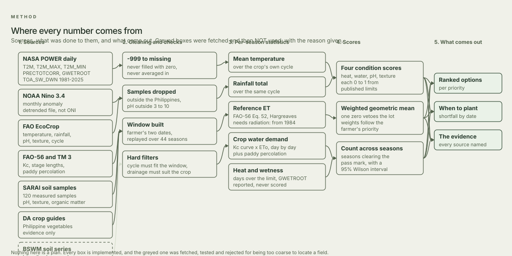

Sources on the left, what was done to them, what came out. The dashed grey box is a source
that was fetched, tested and **rejected** — it is drawn in deliberately, because a dead end
is part of the method.

### From a published limit to a score

Each condition is scored from four numbers published on the crop's EcoCrop sheet. No margin
in this shape is ours.

| What it does | The rule | The result |
|---|---|---|
| The score is 1 inside the crop's optimal range, falls in a straight line to 0 at its absolute limit, and is 0 beyond that. | `s(x) = 0` outside `[a_abs, b_abs]`; rising linearly from `a_abs` to `a_opt`; `1` between `a_opt` and `b_opt`; falling linearly to `b_abs` | 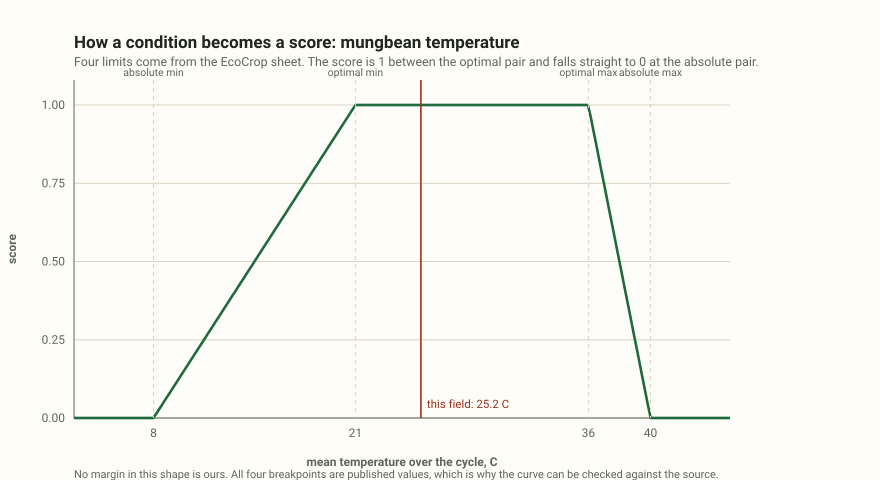 |

### From a score to a verdict

A season's score is **the lowest of the four conditions** — heat, water, soil pH, soil
texture:

```
S = min( heat, water, pH, texture )
```

Nothing is averaged, so good soil cannot make up for missing water. This is the rule
EcoCrop's own model uses, and the limiting-condition method of FAO land evaluation. An
earlier version used a weighted geometric mean; with three conditions fixed at 1.00 it let a
season pass with rain covering 14% of the crop's need. The farmer's priority changes the
order of the crops, never a score.

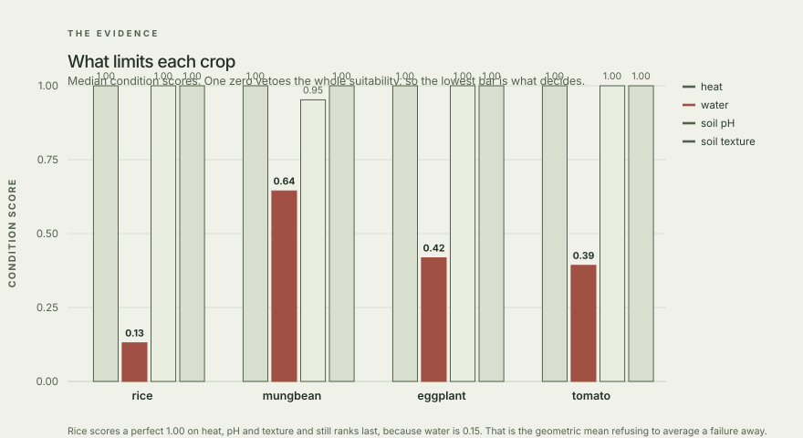

Rice scores 1.00 on heat, pH and texture and still ranks last, because water is 0.11.

### From rainfall to water demand

Water is the condition that decides here, so it gets the most careful treatment. Demand is
built day by day:

| What it does | The rule | The result |
|---|---|---|
| Reference evapotranspiration from temperature and top-of-atmosphere radiation, then scaled by the crop's own coefficient curve through four growth stages. | `ETo = 0.0023 (Tmean + 17.8) √(Tmax − Tmin) · Ra` (FAO-56 Eq. 52)<br>`ETc = Σ Kc(day) × ETo(day)` + paddy percolation | 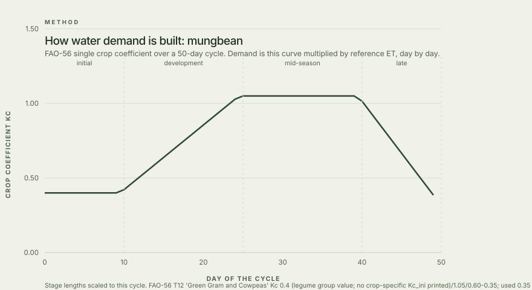 |

Supply is rainfall over the same days. The score is **relative water supply**, `rain ÷ ETc`,
capped at 1 — a comparison for this field and this window, not a regional climate envelope.

---

## What the model says

### When to plant, and why November

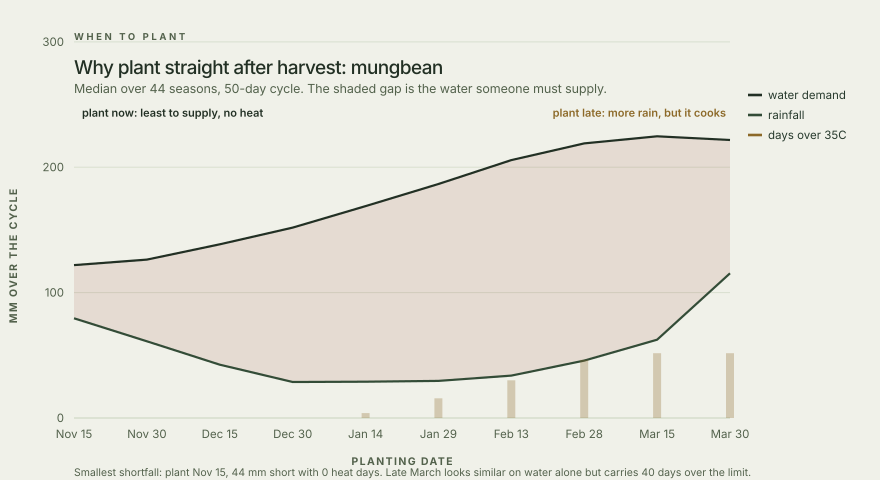

The gap between the two lines is water somebody has to supply. Rainfall inside the window
is very uneven: December to March runs 15–36 mm per month while May runs 182 mm. Planting
late therefore catches more rain — a 60-day mungbean planted 30 March gets 205 mm against
32 mm planted 14 January.

But reference ET climbs from 3.25 mm/day in November to 6.02 mm/day in April, and a cycle
planted in late March spends **42 of its 60 days above 35 °C**. Planting immediately after
harvest has both the smallest shortfall and no heat-stressed days, with root-zone wetness
starting at 0.82 and declining through the cycle.

That is also what farmers already do. The model arrives at established practice from the
data, which is the most reassuring result in it.

### Every season, not just the median

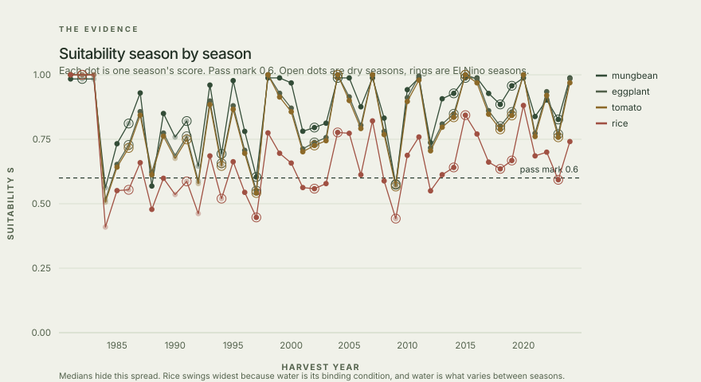

Medians hide spread. Water is the only condition that varies between seasons here, so it
sets the height of every dot.

---

## How far the numbers can be trusted

This is the section to read before the pitch. `python diagnostics.py` prints all of it.

### What holds up

- **The arithmetic is verified, not asserted.** Reference ET reproduces an independent hand
  calculation to the decimal across seven months. The Kc curve holds flat at `Kc_ini`, holds
  `Kc_mid`, and preserves its mean under cycle scaling. 106 tests cover the farmer-facing
  inputs and the statistics.
- **Crop water demand agrees with FAO's own published figures**, which is independent
  corroboration rather than internal consistency: mungbean over 120 days comes to 360 mm
  against FAO's 300–500 mm for beans; tomato over 150 days to 621 mm against FAO's 400–800 mm.
- **Every threshold traces to a named table**, recorded in `crops.csv` alongside the value.

### Two problems that are material

**1. The record is not one climate.**

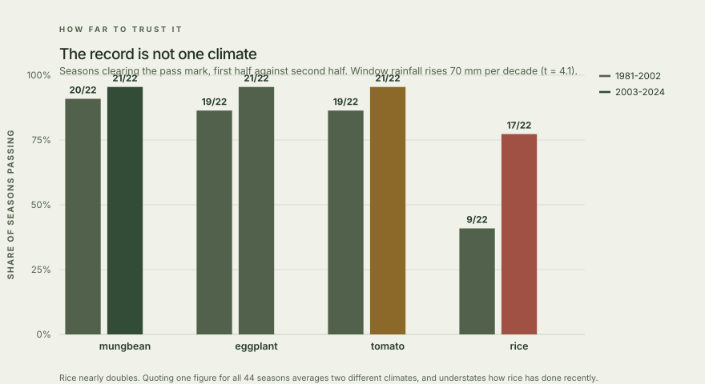

Window rainfall rises **+70.5 mm per decade (t = 4.14)**, and the trend holds in every slice
of the window. Splitting the record in half, mungbean clears the pass mark in 6 of the first
20 scored seasons and 16 of the last 21. **Quoting "22 of 41" to a farmer deciding for 2026
understates how mungbean has done recently.** This is a trend in the NASA record. It has not
been checked against a rain gauge, and records of this kind can drift when the satellites
feeding them change.

A caution on temperature specifically: the first 50 days after harvest warm at
+0.293 °C/decade (t = 4.66), but across the whole window the trend is +0.020 °C/decade
(t = 0.32) and mid-window slices are slightly negative. The warming is real but **confined
to the weeks just after harvest**, which is where the model says to plant. Quote the slice,
never a single figure for the season.

**2. The rainfall input disagrees with itself.**

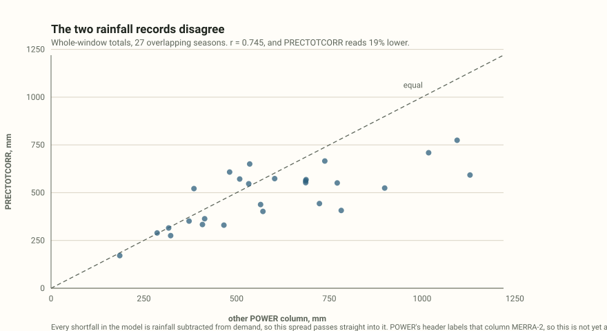

POWER's two precipitation columns correlate at r = 0.745 over 27 overlapping seasons, but
`PRECTOTCORR` reads **19% lower**. Every shortfall in this model is rainfall subtracted from
demand, so that spread passes straight into the headline figures. It also cannot yet be
called an IMERG cross-check: POWER's header labels that column MERRA-2, and raw MERRA-2 is
known to run wet in the tropics, which matches the sign.

### Three smaller ones

**Seasons are not quite independent draws**, which the 95% intervals assume.

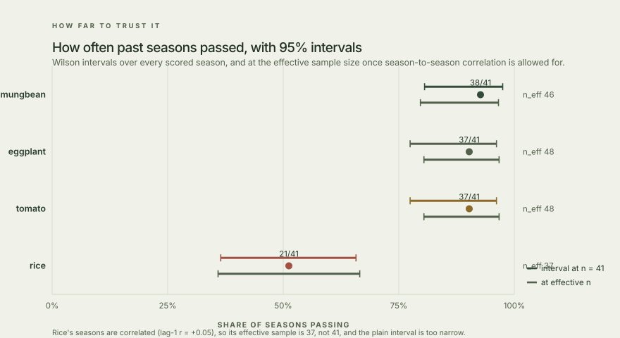

For eggplant and tomato the lag-1 autocorrelation of the pass indicator is close to zero,
so their intervals are fine. Mungbean is +0.142, giving it an effective sample of 31 rather
than 41, so its interval is a little too narrow.

**The pass mark does not decide the leader.**

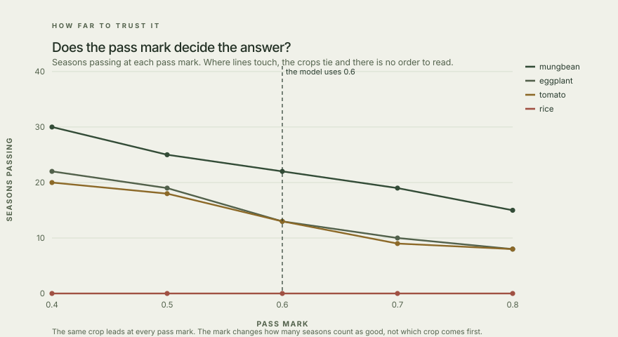

Mungbean leads at every pass mark from 0.4 to 0.8. The mark changes how many seasons count
as good (30 of 41 at 0.4, 15 of 41 at 0.8), not which crop comes first. The 0.6 is still a
team choice.

**No uncertainty propagates.** POWER describes a grid cell roughly 50 km across, not a
one-hectare field. The soil sample is 3.44 km away. Two known biases both inflate demand —
Hargreaves overpredicts under high humidity by FAO-56's own caveat, and `Kc_mid` is
unadjusted from its RHmin ≈ 45% baseline — so **every shortfall is an upper bound**, direction
known, magnitude not. None of this reaches the suitability figure, which carries no interval.

### What cannot be claimed at all

There is **no validation against crop outcomes**, because no farmer outcome data exists for
this field. Accuracy, precision, recall and any "model performance" figure are therefore
unavailable, and presenting one would be the single most damaging thing this project could do.

---

## How space agency and local data were used

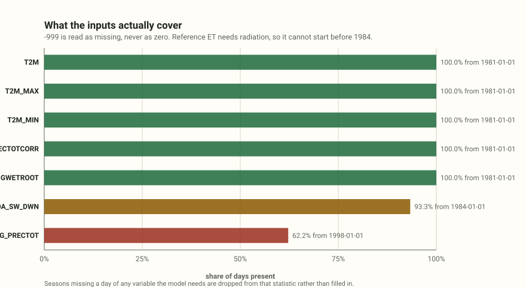

`-999` is read as missing, never as zero and never averaged in. A season missing any day of
a variable the model needs is dropped from that statistic rather than filled.

| Source | What it supplies | How it is used |
|---|---|---|
| **NASA POWER** daily, AG community | `T2M`, `T2M_MAX`, `T2M_MIN`, `PRECTOTCORR`, `GWETROOT`, `TOA_SW_DWN`, 1981–2025 | Temperature and rainfall scores; reference ET; root-zone wetness as reported evidence |
| **NOAA CPC** Oceanic Niño Index | Three-month running mean of the Niño 3.4 anomaly | El Niño season flag: a window averaging +0.5 or more |
| **Pinoy Rice Knowledge Bank** (PhilRice) | Days to maturity by rice variety | Rice's growing time: NSIC Rc222, 106 days direct seeded, 114 transplanted |
| **FAO EcoCrop** | Temperature, rainfall, pH, texture limits and cycle lengths | The four scored conditions. Rainfall limits used **only** as an annual regional screen |
| **FAO-56**, FAO Training Manual 3 | `Kc`, stage lengths, paddy percolation | Crop water demand. Mungbean uses FAO-56's own "Green gram and cowpeas" entry, not a proxy |
| **SARAI** soil samples | 120 measured samples: pH, texture, organic matter | Nearest sample to the field supplies soil pH and texture |
| **DA** regional crop guides | Philippine vegetable requirements | **Evidence only**, never scored |
| **BSWM** soil series | Soil series polygons | **Not used.** See below |

### Soil, and the compromises in it

The field's soil comes from **SARAI_098**, 3.44 km away at the CLSU Compound in Muñoz,
sampled 17 July 2018 under soybean: pH 6.3 (slightly acidic), texture **Loam**, organic
matter 1.36% (low). The sample's own quality flag reads *"Laboratory methods and sampling
depth not stated."*

That lookup replaced two placeholders and **changed the answer**. Texture had been hardcoded
to `heavy` as a demo value; Loam maps to the medium class, which lifted mungbean's texture
score from 0.50 to 1.00 and dropped rice from second place to last on every priority.
Forcing the texture override back to `heavy` reproduces the old ranking exactly, so texture
is the sole driver of that change.

Of the 120 samples, 6 have unreadable coordinates and 114 are usable. **35 share an exact
coordinate with other samples** — the specification would drop those as placeholder
coordinates rather than field locations, and the model does not do that yet. It counts and
reports them instead of quietly including them.

### The source that was rejected

`bswm_soil_map_units.csv` holds 539 Philippine soil map units, and it is committed. It is
not used, because its rows carry **bounding boxes only, hundreds of kilometres wide** — 48
of them "contain" the pilot field. It cannot identify a soil series at a point. Drainage
therefore remains the farmer's own answer, and the run says so every time.

The official BSWM shapefile is what would let drainage come from a map. Until then the
binary well/poorly-drained question is the single biggest hole in the pilot: answering
"water stays on the field" excludes all three alternatives and leaves rice alone.

---

## What this deliberately does not do

These are refusals, not gaps in progress. Each one was a decision to report less rather than
invent more.

- **Heat-stress days are counted and shown, never scored.** A real threshold is crop- and
  stage-specific. Scoring the 35 °C placeholder would repeat the exact error described below.
- **`GWETROOT` stays a 0–1 fraction.** Converting it to millimetres needs rooting depth and
  available water capacity, neither of which is sourced here.
- **The DA guide's harvest figures are not used as cycle lengths.** They are days to the
  *first pick* from a stated basis — 46–50 for eggplant after transplanting, but 4–6 for okra
  after flowering. They do not measure how long a crop holds the field.
- **No crop threshold is interpolated.** Where FAO-56 gives `Kc_end` as a range with no rule
  for choosing, the upper end is used and recorded as a choice.

### The error that shaped all of this

EcoCrop's rainfall figures are **annual**. FAO's datasheets label the row *"Rainfall
(annual)"*, and Hijmans — who wrote the reference implementations — states it outright in
the Recocrop manual. An earlier version of this model compared rainfall accumulated over a
50-day cycle against those limits. Measured rain came out 3–8× below every absolute minimum,
one zero vetoed the geometric mean, and **all four crops scored zero** while the printed
ranking was really just the row order of `crops.csv`.

Changing convention does not rescue it. Under `dismo::ecocrop`'s padded window every crop
still scores zero; against median annual rainfall of 2484 mm, mungbean and tomato fail for
being *too wet*. EcoCrop rainfall answers "can this crop grow in this region's climate at
all" and cannot answer "does this planting window have enough water". That is why the water
balance exists, and why EcoCrop rainfall now appears only as a labelled regional screen.

Two further unit traps were caught the same way: FAO-56 takes `Ra` in mm/day for Eq. 52 but
MJ/m²/day for the adjacent Eq. 50, and the DA harvest figures above. Each was found by
reading the source rather than trusting the number.

---

## Reproducing and extending this

```bash
cd model
python klima_model.py --help          # every farmer answer it accepts
python klima_model.py                 # the pilot's answers
python klima_model.py --drainage poorly_drained
python klima_model.py --soil-ph 4.8 --soil-texture heavy
python diagnostics.py                 # the checks in this document
python sensitivity.py                 # how far the chosen crop values move the answer
python charts.py --out ../docs/images # the charts in this document
python serve.py                       # a local form at 127.0.0.1:8000
python -m unittest discover . -v      # 106 tests
```

`serve.py` runs the real model as a subprocess per submission, so the browser exercises the
same code path as the command line rather than a parallel implementation.

### Integrating this elsewhere

`results.json` is the whole output and is designed to be read by something else. It carries
per-season values, not just medians, so a consumer can recompute counts at a different pass
mark without rerunning anything. `meta.placeholders` names every assumption still standing;
`method` names every formula; `soil.sample` names the measurement with its distance and lab
caveats; `crop_coefficients[*].source` carries the full provenance string for each crop.

A static front end needs no Python at all: the drainage answer, water source and priority
make 24 combinations, all cheap to precompute and serve as JSON.

---

## Known limits

1. POWER describes a grid cell roughly 50 km across; neighbouring fields get identical inputs.
2. EcoCrop limits are global and not specific to a variety or to Nueva Ecija. No FAO-56 stage
   length for any of the three alternatives is tropical — all are Mediterranean, arid or
   Californian.
3. Rice's water demand is **understated** by roughly 300 mm: Training Manual 3's 200 mm
   saturation and 100 mm water layer are not included. Seepage does follow the soil: 4 mm a
   day on heavy clay, 6 on medium soils, 8 on sandy ones.
4. Drainage comes from the farmer alone. No drainage map is used.
5. `Kc` is not climate-adjusted (FAO-56 Eq. 62/65), which needs RHmin and wind that this
   POWER download does not include.
6. Water already in the soil at planting is not counted, and every millimetre of rain in
   the cycle is treated as usable. The first understates a crop planted straight after rice;
   the second flatters any season whose rain came in one storm.
7. Dry years are defined from the same record they are scored against, and the 20% cut-off
   is a team choice.
8. Pests, seed supply, buyers and prices are outside the model.

Item 5 is the cheapest to close: it is a data download away.

---

## Sources

- NASA POWER, Prediction Of Worldwide Energy Resources, daily AG community. https://power.larc.nasa.gov/
- NOAA Climate Prediction Center, Oceanic Niño Index. https://www.cpc.ncep.noaa.gov/data/indices/oni.ascii.txt
- PhilRice, Pinoy Rice Knowledge Bank, rice varieties. https://www.pinoyrice.com/rice-varieties/
- Glover, Kim & Stone (2020). Golden Rice and technology adoption theory: a study of seed choice dynamics among rice growers in the Philippines. *Technology in Society* 60, 101227.
- FAO EcoCrop database. https://www.fao.org/land-water/land/land-governance/land-resources-planning-toolbox/category/details/en/c/1027491/
- Allen, Pereira, Raes & Smith (1998). *Crop evapotranspiration*. FAO Irrigation and Drainage Paper 56. https://www.fao.org/4/x0490e/x0490e00.htm
- Brouwer & Heibloem (1986). *Irrigation Water Needs*. FAO Irrigation Water Management Training Manual 3. https://www.fao.org/4/s2022e/s2022e08.htm
- Doorenbos & Kassam (1979). *Yield response to water*. FAO Irrigation and Drainage Paper 33.
- SARAI, Smarter Approaches to Reinvigorate Agriculture through Science-Based Inventions, soil sample database.
- Philippine Department of Agriculture regional crop production guides.
- BSWM, Bureau of Soils and Water Management, Philippine Soil Series. https://www.bswm.da.gov.ph/download/philippine-soil-series/
- Hijmans et al. (2001), EcoCrop model; `dismo` and `Recocrop` R packages.

Use of NASA data does not imply NASA endorsement.
