# Replaying forty-four seasons: a transparent requirement-matching model for post-rice crop choice in the Philippines

**Team AniNow** · NASA Space Apps Challenge 2026 · *Field Shift: Adapting Farms with NASA Data*

Code, data and every figure: this repository. Computational companion:
[notebooks/klima_analysis.ipynb](../notebooks/klima_analysis.ipynb).

---

## Abstract

Filipino rice farmers hold a field for about 197 days between the November harvest and
the next planting, and must decide whether to plant rice again or a rotation crop. We
present AniNow Klima, a deterministic requirement-matching model that answers this from
open data: 45 years of daily NASA POWER agroclimatology, FAO EcoCrop crop limits, FAO-56
crop water requirements and measured soil samples. For each of 29 crops at 22 sites, the
model replays every fallow season from 1981 to 2024, scores temperature, water, soil pH
and soil texture against published limits, takes the weakest score as the season's
suitability, and counts the seasons that clear a pass mark. It has no fitted parameters.
Across 19,311 scored crop-seasons, at least one crop is suitable at 17 of 22 sites; at
the other five the model returns "no suitable recommendation" rather than a ranking. The
best alternative needs less supplemental water than a second rice crop at all 22 sites
(median 573 mm less, or 5,725 m³ ha⁻¹). Soil pH, not water, is the most frequent
limiting condition. We report the model's statistical weaknesses alongside its results:
window rainfall in the reanalysis is non-stationary at 21 of 22 sites, season scores are
positively autocorrelated in over half of the site-crop pairs, and the El Niño effect is
directionally consistent but under-powered. No harvest records exist for these fields,
so no accuracy figure is reported or claimed.

**Keywords:** crop suitability, crop water requirement, FAO-56, EcoCrop, NASA POWER,
rice-based cropping systems, crop diversification, limiting factor.

---

## 1. Introduction

Lowland rice dominates Philippine smallholder agriculture, and in much of the country
the main crop is harvested at the end of the wet season. The months that follow are dry.
Planting rice again risks a crop without water; leaving the field fallow forgoes a second
income. Diversification after rice is a long-standing extension recommendation, but the
advice is generic: it does not say which crop, on which soil, planted when, or how often
the choice would have worked.

The data needed to make that advice specific are open. NASA POWER provides daily
temperature, precipitation and radiation for any point from 1981. FAO EcoCrop gives
temperature, rainfall, pH and texture limits by species. FAO Irrigation and Drainage
Paper 56 (Allen et al., 1998) gives the standard method for crop water demand. The SARAI
programme provides measured Philippine soil samples. No existing tool joins them at the
level of a single field.

We ask one question: for a given field and fallow window, in how many past seasons were
each crop's published requirements met? The contributions are (i) a deterministic
field-level crop comparison built from open NASA and FAO data, with no fitted parameters
(Section 3); (ii) results for 29 crops at 22 sites over 44 seasons, including an explicit
"no suitable recommendation" outcome (Section 4); and (iii) a statistical appraisal of
those results in the absence of validation data (Sections 4.5–4.7 and 5).

---

## 2. Study sites and data

### 2.1 Sites

The pilot field is at the Science City of Muñoz, Nueva Ecija (15.72 °N, 120.90 °E), in
the Central Luzon rice plain. Twenty-one further sites were added from Ilocos Norte to
North Cotabato (Table 1). Each site is placed at the coordinates of a measured soil
sample, and each has its own NASA POWER download.

POWER's meteorology is on the MERRA-2 grid of 0.5° latitude by 0.625° longitude. The 22
sites fall in **15 distinct grid cells**; sites that share a cell share their weather and
differ only in soil. They are therefore *not* independent tests of the climate, and
every across-site statistic below should be read with that in mind.

**Table 1.** Study sites. Soil pH and texture class are from the nearest measured SARAI
sample. Window rainfall is the median over seasons of total precipitation between
15 November and 30 May.

| # | Site | Lat °N | Lon °E | Grid cell | Soil pH | Texture | Window rain (mm) | Outcome |
|---|---|---|---|---|---|---|---|---|
| 1 | Science City of Muñoz, Nueva Ecija | 15.72 | 120.90 | (31, 193) | 6.3 | medium | 379 | suitable |
| 2 | Batac, Ilocos Norte | 18.06 | 120.55 | (36, 193) | 7.5 | heavy | 305 | none |
| 3 | Echague, Isabela | 16.73 | 121.69 | (33, 195) | 5.4 | medium | 922 | suitable |
| 4 | Los Baños, Laguna | 14.17 | 121.25 | (28, 194) | 6.9 | medium | 940 | suitable |
| 5 | Ligao, Albay | 13.23 | 123.55 | (26, 198) | 5.6 | light | 1269 | suitable |
| 6 | Lambunao, Iloilo | 11.11 | 122.41 | (22, 196) | 6.8 | medium | 596 | suitable |
| 7 | Maramag, Bukidnon | 7.85 | 125.06 | (16, 200) | 4.9 | heavy | 787 | none |
| 8 | Lupao, Nueva Ecija | 15.87 | 120.93 | (32, 193) | 6.3 | medium | 409 | suitable |
| 9 | Piddig, Ilocos Norte | 18.20 | 120.76 | (36, 193) | 5.6 | medium | 305 | suitable |
| 10 | Sinait, Ilocos Sur | 17.86 | 120.46 | (36, 193) | 7.7 | heavy | 305 | none |
| 11 | Jones, Isabela | 16.70 | 121.66 | (33, 195) | 5.0 | light | 922 | suitable |
| 12 | Bay, Laguna | 14.13 | 121.26 | (28, 194) | 5.1 | medium | 940 | suitable |
| 13 | Magdalena, Laguna | 14.28 | 121.45 | (29, 194) | 5.3 | medium | 939 | suitable |
| 14 | Sariaya, Quezon | 13.94 | 121.47 | (28, 194) | 5.4 | heavy | 940 | suitable |
| 15 | Victoria, Oriental Mindoro | 13.15 | 121.19 | (26, 194) | 5.9 | medium | 610 | suitable |
| 16 | Aborlan, Palawan | 9.42 | 118.54 | (19, 190) | 4.4 | light | 442 | none |
| 17 | Alimodian, Iloilo | 10.79 | 122.43 | (22, 196) | 6.0 | medium | 596 | suitable |
| 18 | La Carlota, Negros Occidental | 10.40 | 122.98 | (21, 197) | 5.2 | medium | 592 | suitable |
| 19 | Barili, Cebu | 10.13 | 123.55 | (20, 198) | 7.4 | heavy | 607 | suitable |
| 20 | Claveria, Misamis Oriental | 8.61 | 124.88 | (17, 200) | 5.1 | heavy | 870 | none |
| 21 | Kabacan, North Cotabato | 7.11 | 124.86 | (14, 200) | 5.9 | medium | 669 | suitable |
| 22 | Kidapawan, North Cotabato | 7.08 | 125.11 | (14, 200) | 5.6 | medium | 669 | suitable |

Soil pH across the sites runs from 4.4 to 7.7 (median 5.6); thirteen soils are medium
textured, six heavy and three light. Median window rainfall runs from 305 to 1,269 mm.

### 2.2 Datasets

**Table 2.** Data used. All are open. Nothing is downloaded at run time: every file is
committed in `model/`, and the FAO source pages are archived in `model/sources/`.

| Dataset | Provider | Variables used (unit) | Resolution and period | Role in the model |
|---|---|---|---|---|
| POWER daily agroclimatology | NASA LaRC POWER; source MERRA-2 | `T2M`, `T2M_MAX`, `T2M_MIN` (°C); `PRECTOTCORR` (mm d⁻¹); `GWETROOT` (0–1) | 0.5° × 0.625°, daily, 1 Jan 1981 – 31 Dec 2025 (16,436 days per site) | Cycle temperature, rainfall, reference ET; root-zone wetness reported only |
| POWER top-of-atmosphere irradiance | NASA LaRC POWER; source CERES SYN1deg | `TOA_SW_DWN` (MJ m⁻² d⁻¹) | daily, from 1 Jan 1984 | Extraterrestrial radiation $R_a$ in reference ET |
| POWER second precipitation column | NASA LaRC POWER | `IMERG_PRECTOT` (mm d⁻¹) | daily, from 1 Jan 1998; pilot site only | Rainfall cross-check, not scored |
| Oceanic Niño Index | NOAA Climate Prediction Center | 3-month running mean Niño 3.4 SST anomaly (°C) | monthly, 1950 – present | El Niño season flag |
| EcoCrop | FAO | Temperature, annual rainfall and pH breakpoints; texture and drainage classes; cycle length | 23 crop sheets | Condition limits |
| Crop production guides | Philippine Department of Agriculture | Recommended temperature and pH ranges | 6 crops | Screening where EcoCrop limits are unsuitable or absent |
| Irrigation and Drainage Paper 56 | FAO (Allen et al., 1998) | Crop coefficients $K_c$ (Table 12); stage lengths (Table 11) | 29 crops | Crop water demand |
| Irrigation Water Management Training Manual 3 | FAO (Brouwer & Heibloem, 1986) | Paddy percolation (mm d⁻¹) by soil | 3 soil classes | Rice water demand |
| Soil samples | SARAI, University of the Philippines Los Baños | pH, texture, organic matter | 120 measured samples, 2018 | Field soil pH and texture |
| Rice varietal data | PhilRice, Pinoy Rice Knowledge Bank | Maturity of NSIC Rc222 (days) | 106 d direct seeded, 114 d transplanted | Rice cycle length |

**Missing data.** POWER marks a missing value as `-999`. At the pilot site the five
MERRA-2 variables are complete for all 16,436 days; `TOA_SW_DWN` is missing for 1,095
days (6.7%), all before 1984. A missing value is treated as missing — never as zero and
never interpolated. A season lacking any day of a variable it needs is dropped from that
statistic. Because reference evapotranspiration needs $R_a$, the 1981–1983 seasons cannot
be scored on a rainfed field, leaving **41 scorable seasons of 44**.

**Soil.** Each site takes pH and texture from the nearest SARAI sample within 10 km;
texture is reduced to three classes (light, medium, heavy) to match EcoCrop. The samples
do not state laboratory method or sampling depth. Thirty-five of the 120 share
coordinates with another sample. A Bureau of Soils and Water Management soil-series table
was also obtained and deliberately not used: its entries are bounding boxes hundreds of
kilometres wide, so dozens of series "contain" any one field.

**Crops.** Twenty-nine crops are included (Appendix A). Twenty-three are scored on
EcoCrop's four-breakpoint limits. Six are known only from a Department of Agriculture
guide, which gives a recommended range but no survival limits; those are screened, not
scored (Section 3.2). All 29 carry FAO-56 coefficients and stage lengths, and every row
of `model/crops.csv` records the source of each number.

---

## 3. Methods

The model is a composition of published rules, stated here in full. The implementation
is `model/klima_model.py`.

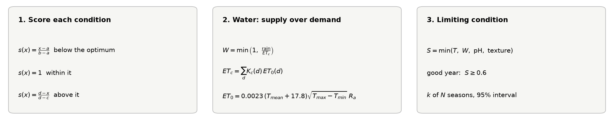

**Figure 1.** The model in three steps.

### 3.1 Seasons and the fallow window

For each harvest year $y \in \{1981, \dots, 2024\}$ the fallow window runs from the
harvest date to the day before the next rice planting. With the default dates
(15 November and 31 May) the window is 197 days. Each crop is scored over its shortest
cycle $n$ starting at the planting date; alternative planting dates at 15-day offsets are
evaluated separately (Section 4.1).

### 3.2 Feasibility filters

Scores are computed only for crops that pass three hard filters. A crop is excluded if
(F1) land preparation plus its cycle plus picking plus clearing exceeds the window;
(F2) the farmer reports that water stays on the field and the crop requires drained soil;
or (F3) under the same answer the source does not state the crop's drainage need. The six
guide-only crops, and two cool-season crops whose global EcoCrop limits would pass them
in the tropical lowlands, are additionally screened against the Department of
Agriculture's recommended temperature (and, for guide-only crops, pH) range. An excluded
crop is reported with its reason and is never scored or ranked.

### 3.3 Condition scores

EcoCrop gives four breakpoints for each condition: absolute minimum $a$, optimal minimum
$b$, optimal maximum $c$, absolute maximum $d$. A measurement $x$ scores

$$
\sigma(x;\,a,b,c,d) =
\begin{cases}
0 & x < a \ \text{or}\ x > d \\
(x-a)/(b-a) & a \le x < b \\
1 & b \le x \le c \\
(d-x)/(d-c) & c < x \le d
\end{cases}
$$

Temperature is scored on the mean 2 m air temperature over the cycle, and soil pH on the
sample value. Soil texture has no numeric axis and is scored 1 if the field's class is
among the crop's optimal classes, 0.5 if only among its tolerated classes, and 0
otherwise. **The 0.5 is our own choice**; its consequences are measured in Section 4.7.

EcoCrop's rainfall limits are annual totals and are not used to score a single cycle. An
early version of this model did so, comparing a 60-day rainfall total with an annual
limit; the error was found from the units and the water condition was replaced by the
supply–demand ratio below.

### 3.4 Water: supply against demand

Reference evapotranspiration follows the temperature-based Hargreaves equation
(FAO-56 Eq. 52; Hargreaves & Samani, 1985), because the POWER download carries no
humidity or wind:

$$
ET_0 = 0.0023\,(T_{\text{mean}} + 17.8)\,\sqrt{T_{\max} - T_{\min}}\;R_a
$$

with $R_a$ in mm d⁻¹ (POWER `TOA_SW_DWN` multiplied by 0.408). Crop water demand over a
cycle of $n$ days is the single-crop-coefficient sum of FAO-56 Chapter 6,

$$
ET_c = \sum_{i=0}^{n-1} K_c(i)\,ET_0(i) \;+\; n\,P
$$

where $K_c(i)$ holds at $K_{c,\text{ini}}$ through the initial stage, rises linearly to
$K_{c,\text{mid}}$, holds, and falls linearly to $K_{c,\text{end}}$ (Appendix B).
FAO's tabulated stage lengths are rescaled in proportion onto the cycle $n$, as FAO-56
directs for local adaptation. $P$ is paddy percolation, applied to rice only: 4, 6 and
8 mm d⁻¹ on heavy, medium and light soils (Brouwer & Heibloem, 1986).

The water score is relative water supply, capped at one:

$$
W = \min\left(1,\ \frac{R}{ET_c}\right)
$$

where $R$ is precipitation over the same days. The shortfall $\max(0, ET_c - R)$ is
reported in millimetres as the irrigation the farmer would have to find. On an irrigated
field water is not a limiting condition and $W$ is omitted from the score, but the
shortfall is still reported.

### 3.5 Season suitability

The suitability of a crop in a season is its weakest condition,

$$
S = \min\bigl(\sigma_T,\ W,\ \sigma_{\text{pH}},\ \tau\bigr)
$$

This is the limiting-factor rule (Liebig's law of the minimum), used by the EcoCrop
suitability model (Hijmans et al., 2001) and by FAO land evaluation (FAO, 1976). An
arithmetic mean would let a favourable soil compensate for absent water. A condition that
could not be scored is omitted from the minimum, with two safeguards: a rainfed season
with no water score has no suitability at all, and a crop with a condition that could
never be scored is ranked below every fully scored crop.

### 3.6 From seasons to a statement

A season is a *good year* when $S \ge \theta$, with $\theta = 0.6$. **The pass mark is
our own choice**; Section 4.6 shows what it does and does not decide. For each crop we
report $k$ good years of $N$ scorable seasons with a Wilson (1927) 95% score interval,
chosen over the normal approximation because $k = 0$ and $k = N$ both occur. Seasons are
also tabulated separately for the driest fifth of seasons and for El Niño seasons, defined
as a window-mean ONI of +0.5 °C or more.

Crops are ordered by good years, then median suitability, then smaller shortfall. A crop
is *suitable* only if its median season reaches the pass mark and every condition could
be scored. If no crop is suitable the result is **"no suitable recommendation"**; the
first crop in the order is not presented as advice.

### 3.7 Statistical appraisal

Because there are no outcome data, the appraisal concerns internal consistency and input
quality, not predictive skill. All tests are implemented in `model/analysis.py` using the
standard library and are checked against hand-worked cases in the test suite.

| Question | Method |
|---|---|
| Uncertainty of a count of good years | Wilson score interval (Wilson, 1927) |
| Independence of seasons | Lag-1 autocorrelation $r_1$; effective sample size $N(1-r_1)/(1+r_1)$ for $r_1 > 0$ (Bayley & Hammersley, 1946) |
| Trend in window rainfall | Least squares; Mann–Kendall test (Mann, 1945; Kendall, 1975); Sen's slope (Sen, 1968); Benjamini–Hochberg adjustment over 22 sites (Benjamini & Hochberg, 1995) |
| Good years in the first versus second half of the record | Fisher's exact test (Fisher, 1935) |
| Good years in El Niño versus other seasons | Fisher's exact test |
| Dependence of suitability on rainfall | Spearman's rank correlation (Spearman, 1904) |
| Best alternative versus rice across sites | Two-sided sign test |
| Influence of chosen constants | One-at-a-time perturbation (`model/sensitivity.py`) |

### 3.8 Verification

Reference ET reproduces an independent hand calculation to the decimal over seven months,
and crop water demand agrees with the per-cycle figures FAO publishes. All 23
EcoCrop-scored crops are compared number by number with their archived FAO sheets by an
automated test. The suite comprises 159 tests of the inputs, the scoring functions, the
water balance, the statistics, and the counts reported in Section 4.

---

## 4. Results

Unless stated otherwise, results are for a rainfed, well-drained field, harvest on
15 November and next planting on 31 May, with rice as the current crop.

### 4.1 Planting date at the pilot site

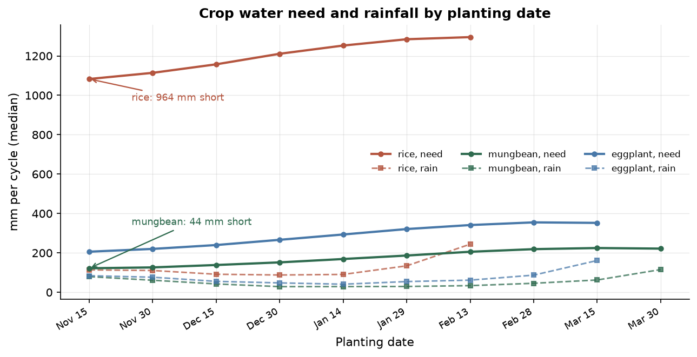

**Figure 2.** Median crop water need (solid) and rainfall over the same days (dashed) for
each candidate planting date at Muñoz.

A second rice crop planted on harvest day needs 1,083 mm over its 106-day cycle and
receives 114 mm of rain: a shortfall of 964 mm. Mungbean planted the same day is 44 mm
short. Rainfall in the window is very uneven — 15 to 36 mm a month from December to
March against 182 mm in May — so later planting catches more rain, but reference ET rises
from 3.25 mm d⁻¹ in November to 6.02 mm d⁻¹ in April and days above 35 °C multiply.
Planting immediately after harvest gives both the smallest shortfall and no heat-stressed
days. This agrees with existing farmer practice, which the model was not told.

### 4.2 Crop comparison at the pilot site

**Table 3.** The four crops the pilot was built on, Muñoz, rainfed. Suitability is the
median season.

| Crop | Cycle (d) | Suitability | Good years | Wilson 95% | Shortfall (mm) |
|---|---|---|---|---|---|
| Mungbean | 50 | 0.64 | 22 of 41 | 39%–68% | 44 |
| Eggplant | 70 | 0.42 | 13 of 41 | 20%–47% | 115 |
| Tomato | 70 | 0.39 | 13 of 41 | 20%–47% | 127 |
| Rice | 106 | 0.11 | 0 of 41 | 0%–9% | 964 |

At this site temperature, pH and texture score 1.00 (pH 0.95 for mungbean) in every
season, so suitability equals the water score: 0.64 means rain met 64% of mungbean's
need in the median season. With all 29 crops rated, radish ties mungbean at 22 good years
of 41. Rice passes in no rainfed season; on an irrigated field every crop in Table 3
passes in all 44.

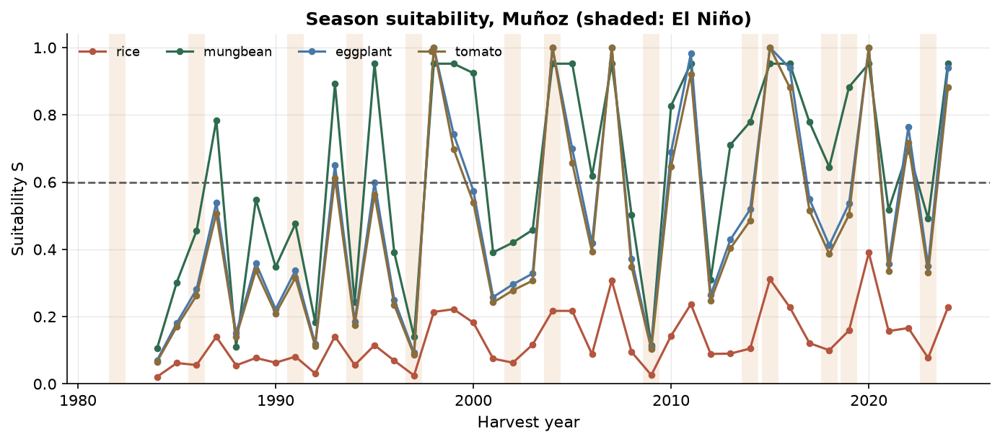

**Figure 3.** Suitability in each scorable season at Muñoz. Shaded bands are El Niño seasons.

### 4.3 Across 22 sites

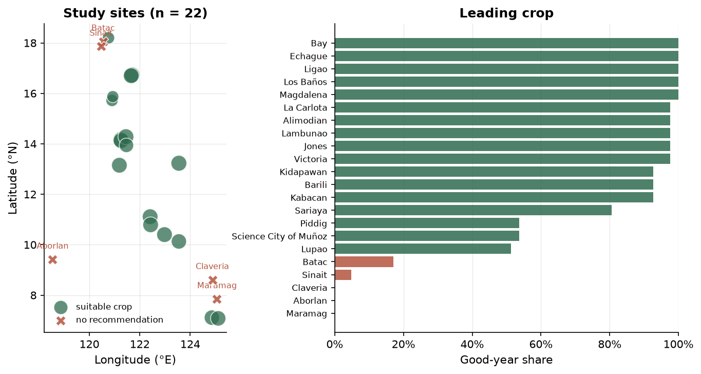

**Figure 4.** Left: the 22 sites; crosses mark sites with no suitable recommendation.
Right: share of scorable seasons in which the leading crop was a good year.

Of 638 site-crop pairs, 471 were rated and 167 were excluded by a filter or a guide
screen, giving 19,311 scored crop-seasons. At least one crop is suitable at **17 of 22
sites**. The leading crop differs by site: mungbean at six, radish at four, cowpea at
three, and snap bean, squash, rice and sweet sorghum at one each. At **five sites**
(Batac, Maramag, Sinait, Aborlan, Claveria) no crop is suitable: soil pH or a heavy
texture caps every crop regardless of rainfall. Rain alone covered the leading crop's
water need in the median season at 15 sites.

### 4.4 Water saved against a second rice crop

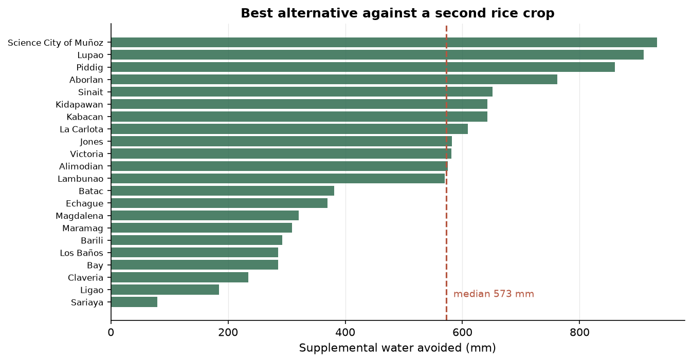

**Figure 5.** Supplemental water the best alternative avoids, relative to a second rice crop.

The best alternative needs less supplemental water than a second rice crop at **all 22
sites**: median 573 mm (5,725 m³ ha⁻¹), range 79 to 932 mm. It also has more good years
than rice at 17 sites, fewer at two and the same at three (sign test, $p = 0.0007$,
ties excluded). The sign test counts sites, and sites sharing a grid cell are not
independent, so the $p$-value is indicative. Rice demand excludes the 200 mm saturation
and 100 mm standing-water layer of Training Manual 3, so the saving is a lower bound.

### 4.5 What limits suitability

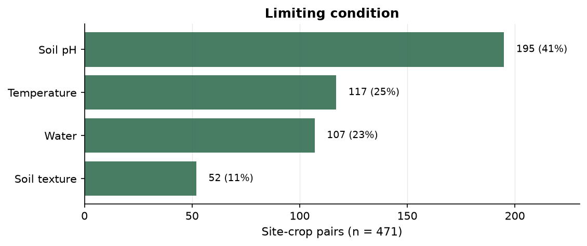

**Figure 6.** The weakest condition in the median season, for each rated site-crop pair.

Across the 471 rated pairs the limiting condition is soil pH in 195 (41%), temperature in
117 (25%), water in 107 (23%) and soil texture in 52 (11%). The pilot site, where water
limits every crop, is therefore not typical of the set. Season suitability follows
window rainfall closely where water is limiting (median Spearman $\rho = 0.73$ over the
316 pairs whose score varies between seasons) and not at all where soil caps the score.

### 4.6 Sensitivity to the pass mark and other chosen constants

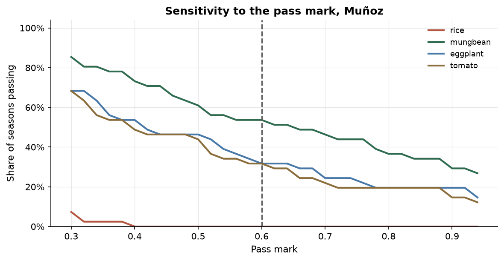

**Figure 7.** Share of scorable seasons that pass, as the pass mark varies, at Muñoz.

Among the four pilot crops, mungbean leads at every pass mark from 0.4 to 0.8; the mark
changes how many seasons count as good (30 of 41 at 0.4, 15 of 41 at 0.8), not the
order. One-at-a-time perturbation of the other chosen values gives the same conclusion.
Moving mungbean's initial $K_c$ by ±0.1 changes its shortfall from 39 to 50 mm; rice's
shortfall is 752, 964 and 1,176 mm on heavy, medium and light soil, and 941 to 1,129 mm
across published cycle lengths of 104 to 120 days. In the least favourable combination
for the recommendation — mungbean at its longest cycle with its highest coefficients, rice
at its shortest cycle on its most retentive soil — mungbean is 269 mm short and rice
719 mm. The order of crops by shortfall did not change under any perturbation tested.

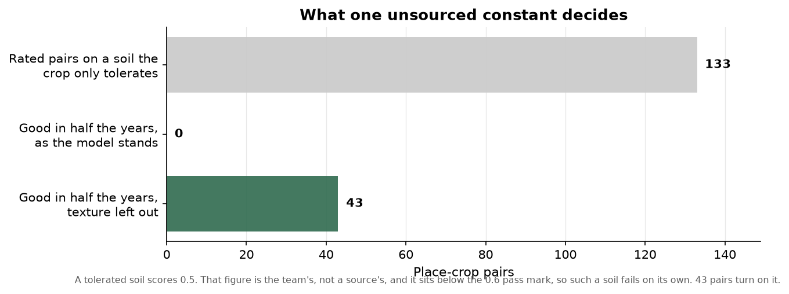

**Figure 8.** Site-crop pairs on a soil the crop only tolerates, and how many would be
good in half the years with and without the texture score.

The texture score is the exception. A tolerated soil scores 0.5, below the pass mark, so
it fails a crop on its own: 133 rated pairs sit on such a soil, none is good in half the
years, and **43 would be** if texture were left out. That is the size of one unsourced
constant, and it remains an open decision.

### 4.7 How far the counts can be trusted

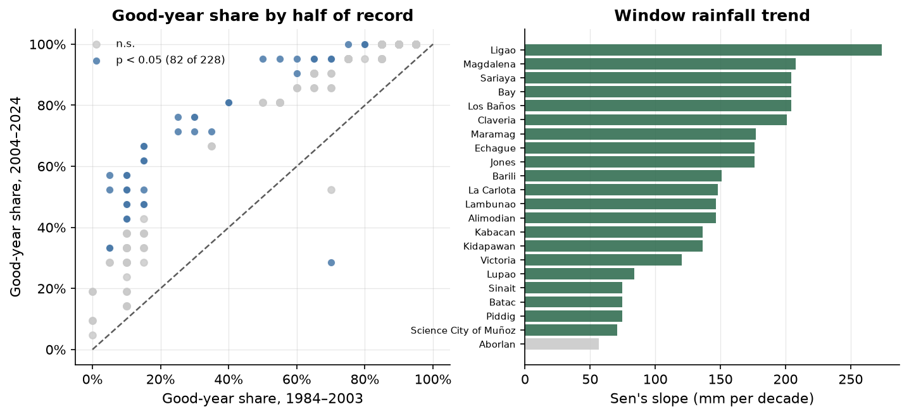

**Figure 9.** Left: good-year share in 1984–2003 against 2004–2024 for each site-crop
pair with both good and bad years. Right: Sen's slope of window rainfall by site.

**The record is not stationary.** Window rainfall increases at 21 of 22 sites after
Benjamini–Hochberg adjustment (false discovery rate 5%) and decreases at none; at Muñoz
the trend is +70.5 mm per decade (least squares, $t = 4.14$; Sen's slope +70.8). Of 228
pairs with both good and bad years, 82 differ between the two halves of the record at
$p < 0.05$, against about 11 expected by chance. At Muñoz mungbean was a good year in 6
of the first 20 scored seasons and 16 of the last 21, so the pooled "22 of 41"
understates recent seasons. This is a trend in a reanalysis product. It has not been
checked against rain gauges and we do not present it as evidence of climate change.

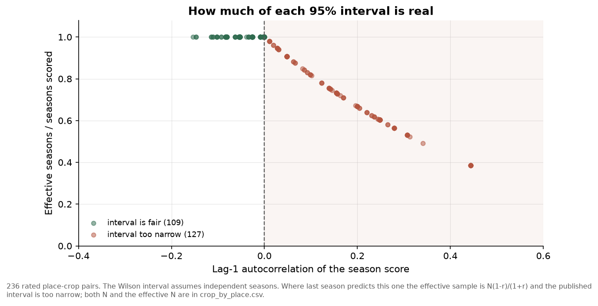

**Figure 10.** Lag-1 autocorrelation of the season score against the ratio of effective to
actual sample size.

**Seasons are not independent.** The season score is positively autocorrelated in 127 of
236 pairs for which it can be computed, so the Wilson intervals for those pairs are too
narrow. For mungbean at Muñoz $r_1 = +0.142$, an effective sample of 31 rather than 41.

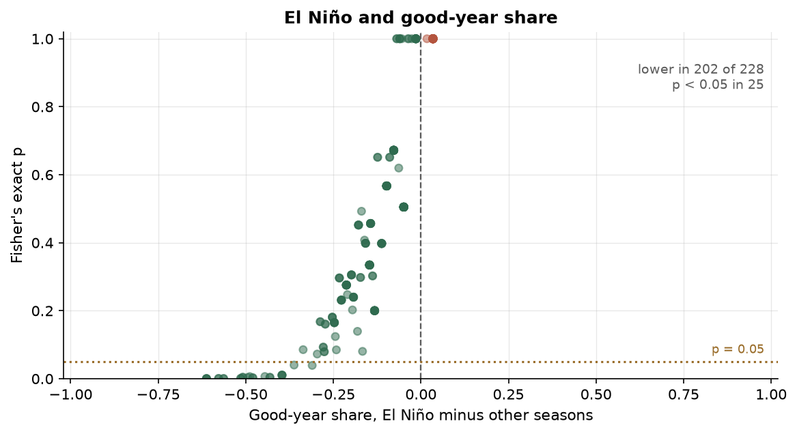

**Figure 11.** Difference in good-year share between El Niño and other seasons against
Fisher's exact $p$.

**The El Niño effect is consistent in direction but not established.** The good-year
share is lower in El Niño seasons in 202 of 228 pairs, but only 25 reach $p < 0.05$,
against about 11 expected by chance. With 12 or 13 El Niño seasons per site the test has
little power. We report the direction and make no claim of effect size.

**The rainfall input is uncertain.** At the pilot site POWER's two precipitation columns
correlate at $r = 0.745$, with `PRECTOTCORR` 19% lower. Since every shortfall is demand
minus rainfall, that spread passes directly into the headline figures. The second column
is labelled MERRA-2 in POWER's own header, so it is not an independent satellite check.

---

## 5. Discussion

**What the model is.** It is a transparent accounting of published requirements against
recorded weather. Its main findings are robust to the constants we chose: after a
November harvest a second rainfed rice crop is short of water by several hundred
millimetres at every site, short-cycle legumes and root crops are not, and the best
alternative differs by site mainly because soils differ. That soil pH limits more
site-crop pairs than water does was not expected at the outset, and suggests that a soil
test is the most valuable single thing a farmer can add to the model's inputs.

**What it is not.** It is not validated. No harvest record exists for these fields, so
accuracy, precision, recall and any measure of predictive skill are undefined, and none
is reported. A good year means that published requirements were met, not that a crop was
harvested or sold at a profit. The model has no yields, prices or labour, and it is not a
forecast: every figure is a count or a median over past seasons.

**Limitations.**

1. *Demand is an upper bound.* Hargreaves overestimates $ET_0$ in humid air, and $K_c$ is
   not adjusted for local humidity and wind (FAO-56 Eq. 62) because the download lacks
   both. Shortfalls for upland crops are therefore overstated; rice demand is at the same
   time understated by roughly 300 mm (Section 4.4).
2. *Stage lengths are not tropical.* FAO-56 Table 11 has no Philippine entry for any
   alternative crop; the lengths used are Mediterranean, arid or Californian, rescaled.
3. *Soil water is not carried.* Each cycle starts with an empty profile and all rain
   counts as usable; stored moisture after the wet season and runoff losses are ignored.
4. *Weather is a grid-cell average* of roughly 55 by 67 km, not a reading at the field.
5. *Soil is one sample per site*, of unstated depth and method, up to 10 km away.
6. *Drainage is the farmer's answer.* No usable soil-series map was available.
7. *Chosen constants.* The pass mark (0.6), the tolerated-texture score (0.5), the
   medium-soil percolation (6 mm d⁻¹), the dry-season share (20%) and each $K_c$ picked
   within a printed range are ours.
8. *No agronomist has reviewed* the added crops or sites; only the pilot site has been
   examined in detail.

**Next steps.** Field validation against harvest records is the first priority and the
only route to a statement about accuracy. Replacing Hargreaves with Penman–Monteith needs
only a second POWER download with humidity and wind; Philippine stage lengths from
PhilRice or Department of Agriculture trials would replace the rescaled FAO values; and a
gauge comparison would settle whether the rainfall trend is real.

---

## 6. Conclusion

Open NASA and FAO data are sufficient to turn generic diversification advice into a
field-specific, checkable statement. For a rainfed field harvested in November, the
record from 1981 to 2024 does not support a second rice crop at any of 22 Philippine
sites, and supports a short-cycle alternative at 17 of them, saving a median of 573 mm
of irrigation. Where the soil rules every crop out, the model says so. Every step from
satellite record to recommendation can be read and re-run.

---

## Data and code availability

All input data, archived source pages, code, tests, tables and figures are in this
repository. `python model/klima_model.py` reproduces the pilot results;
`python model/analysis.py --out docs/analysis` reproduces every table; and
`python notebooks/make_figures.py` reproduces every figure. The model requires only the
Python standard library.

NASA POWER data were obtained from the NASA Langley Research Center (LaRC) POWER Project,
funded through the NASA Earth Science/Applied Science Program. Use of NASA data does not
imply NASA endorsement.

## Acknowledgements

Most of the code, the analysis scripts and the text of this paper were drafted with an
AI assistant (Claude, Anthropic), directed and reviewed by the team. The model contains
no machine learning, and all figures are plotted by code from its output.

## References

Allen, R. G., Pereira, L. S., Raes, D., & Smith, M. (1998). *Crop evapotranspiration:
Guidelines for computing crop water requirements.* FAO Irrigation and Drainage Paper 56.
Rome: FAO. https://www.fao.org/4/x0490e/x0490e00.htm

Bayley, G. V., & Hammersley, J. M. (1946). The "effective" number of independent
observations in an autocorrelated time series. *Supplement to the Journal of the Royal
Statistical Society, 8*(2), 184–197.

Benjamini, Y., & Hochberg, Y. (1995). Controlling the false discovery rate: A practical
and powerful approach to multiple testing. *Journal of the Royal Statistical Society:
Series B, 57*(1), 289–300.

Brouwer, C., & Heibloem, M. (1986). *Irrigation water management: Irrigation water
needs.* Training Manual No. 3. Rome: FAO. https://www.fao.org/4/s2022e/s2022e07.htm

FAO. (1976). *A framework for land evaluation.* FAO Soils Bulletin 32. Rome: FAO.

FAO. *EcoCrop: Crop Ecological Requirements Database.*
https://ecocrop.apps.fao.org/ecocrop/srv/en/home

Fisher, R. A. (1935). *The design of experiments.* Edinburgh: Oliver and Boyd.

Gelaro, R., McCarty, W., Suárez, M. J., et al. (2017). The Modern-Era Retrospective
Analysis for Research and Applications, Version 2 (MERRA-2). *Journal of Climate,
30*(14), 5419–5454.

Hargreaves, G. H., & Samani, Z. A. (1985). Reference crop evapotranspiration from
temperature. *Applied Engineering in Agriculture, 1*(2), 96–99.

Hijmans, R. J., Guarino, L., Cruz, M., & Rojas, E. (2001). Computer tools for spatial
analysis of plant genetic resources data: 1. DIVA-GIS. *Plant Genetic Resources
Newsletter, 127*, 15–19.

Kendall, M. G. (1975). *Rank correlation methods* (4th ed.). London: Charles Griffin.

Mann, H. B. (1945). Nonparametric tests against trend. *Econometrica, 13*(3), 245–259.

NASA Langley Research Center. *Prediction Of Worldwide Energy Resources (POWER) Project.*
https://power.larc.nasa.gov/

NOAA Climate Prediction Center. *Oceanic Niño Index.*
https://www.cpc.ncep.noaa.gov/data/indices/oni.ascii.txt

PhilRice. *Pinoy Rice Knowledge Bank: Rice varieties.*
https://www.pinoyrice.com/rice-varieties/

Sen, P. K. (1968). Estimates of the regression coefficient based on Kendall's tau.
*Journal of the American Statistical Association, 63*(324), 1379–1389.

Spearman, C. (1904). The proof and measurement of association between two things.
*American Journal of Psychology, 15*(1), 72–101.

Wilson, E. B. (1927). Probable inference, the law of succession, and statistical
inference. *Journal of the American Statistical Association, 22*(158), 209–212.

---

## Appendix A. Crops

**Table A1.** The 29 crops. "Cycle scored" is the shortest cycle, used for all headline
figures. Pooled good seasons add seasons across sites that share years and grid cells:
they show the size of the evidence, not an independent sample. A dash means the crop was
excluded at every site by a filter or guide screen.

| Crop | Local name | Species | Limits | Cycle scored (d) | Kc ini / mid / end | Sites rated | Pooled good seasons |
|---|---|---|---|---|---|---|---|
| Rice | Palay | *Oryza sativa* | EcoCrop | 106 | 1.05 / 1.20 / 0.90 | 22 | 203 of 902 |
| Mungbean | Munggo | *Vigna radiata* | EcoCrop | 50 | 0.40 / 1.05 / 0.35 | 22 | 464 of 902 |
| Eggplant | Talong | *Solanum melongena* | EcoCrop | 70 | 0.60 / 1.05 / 0.90 | 22 | 433 of 902 |
| Tomato | Kamatis | *Solanum lycopersicum* | EcoCrop | 70 | 0.60 / 1.15 / 0.90 | 22 | 309 of 902 |
| Squash | Kalabasa | *Cucurbita maxima* | DA guide | 100 | 0.50 / 1.00 / 0.80 | 8 | 226 of 328 |
| Yardlong bean | Sitaw | *Vigna unguiculata* subsp. *sesquipedalis* | DA guide | 110 | 0.40 / 1.05 / 0.60 | 8 | 177 of 328 |
| Snap bean | Habichuelas | *Phaseolus vulgaris* | DA guide | 75 | 0.50 / 1.05 / 0.90 | 12 | 271 of 492 |
| Cabbage | Repolyo | *Brassica oleracea* var. *capitata* | DA guide | 165 | 0.70 / 1.05 / 0.95 | 0 | — |
| Lettuce | Letsugas | *Lactuca sativa* | DA guide | 75 | 0.70 / 1.00 / 0.95 | 0 | — |
| Potato | Patatas | *Solanum tuberosum* | DA guide | 115 | 0.50 / 1.15 / 0.75 | 3 | 85 of 123 |
| Maize | Mais | *Zea mays* | EcoCrop | 125 | 0.30 / 1.20 / 0.60 | 22 | 634 of 902 |
| Sweet corn | Matamis na mais | *Zea mays* ssp. *saccharata* | EcoCrop | 80 | 0.30 / 1.15 / 1.05 | 22 | 389 of 902 |
| Peanut | Mani | *Arachis hypogaea* | EcoCrop | 130 | 0.40 / 1.15 / 0.60 | 22 | 344 of 902 |
| Soybean | Soya | *Glycine max* | EcoCrop | 85 | 0.40 / 1.15 / 0.50 | 22 | 380 of 902 |
| Sweet potato | Kamote | *Ipomoea batatas* | EcoCrop | 125 | 0.50 / 1.15 / 0.65 | 22 | 613 of 902 |
| Cassava | Kamoteng kahoy | *Manihot esculenta* | EcoCrop | 210 | 0.30 / 0.80 / 0.30 | 0 | — |
| Onion | Sibuyas | *Allium cepa* | EcoCrop | 150 | 0.70 / 1.05 / 0.75 | 22 | 239 of 902 |
| Sweet pepper | Atsal | *Capsicum annuum* | EcoCrop | 125 | 0.60 / 1.05 / 0.90 | 22 | 309 of 902 |
| Watermelon | Pakwan | *Citrullus lanatus* | EcoCrop | 80 | 0.40 / 1.00 / 0.75 | 22 | 221 of 902 |
| Melon | Melon | *Cucumis melo* | EcoCrop | 120 | 0.50 / 1.05 / 0.75 | 22 | 197 of 902 |
| Carrot | Karot | *Daucus carota* | EcoCrop | 100 | 0.70 / 1.05 / 0.95 | 0 | — |
| Sesame | Linga | *Sesamum indicum* | EcoCrop | 100 | 0.35 / 1.10 / 0.25 | 22 | 384 of 902 |
| Sweet sorghum | Batad | *Sorghum bicolor* | EcoCrop | 130 | 0.30 / 1.20 / 1.05 | 22 | 220 of 902 |
| Broccoli | Brokoli | *Brassica oleracea* var. *italica* | EcoCrop | 135 | 0.70 / 1.05 / 0.95 | 22 | 179 of 902 |
| Cucumber | Pipino | *Cucumis sativus* | EcoCrop | 105 | 0.60 / 1.00 / 0.75 | 22 | 293 of 902 |
| Radish | Labanos | *Raphanus sativus* | EcoCrop | 35 | 0.70 / 0.90 / 0.85 | 22 | 381 of 902 |
| Garden pea | Sitsaro | *Pisum sativum* | EcoCrop | 90 | 0.50 / 1.15 / 1.10 | 0 | — |
| Cauliflower | Koliplor | *Brassica oleracea* var. *botrytis* | EcoCrop | 140 | 0.70 / 1.05 / 0.95 | 22 | 177 of 902 |
| Cowpea | Paayap | *Vigna unguiculata* | EcoCrop | 110 | 0.40 / 1.05 / 0.35 | 22 | 498 of 902 |

Maize and sweet potato have many good seasons but are never the recommendation: their
EcoCrop sheets print no soil texture, so one condition cannot be scored and they rank
below fully scored crops.

## Appendix B. Supplementary figures and tables

| Item | File |
|---|---|
| How a recommendation is reached | [figures/fig01-how-it-decides.png](figures/fig01-how-it-decides.png) |
| Scoring function and coefficient curves | [figures/fig02-the-function.png](figures/fig02-the-function.png) |
| Suitability against rainfall (Spearman) | [figures/fig13-score-follows-rain.png](figures/fig13-score-follows-rain.png) |
| Margin between the two weakest conditions | [figures/fig14-limiting-margin.png](figures/fig14-limiting-margin.png) |
| Every site, crop and test statistic | [analysis/pitch_stats.md](analysis/pitch_stats.md) and the four CSV tables beside it |
